# 넥스트페이지 (Next Page)

> **내가 선택하는 대로 완성되는 소설.**
> 화마다 2~3개의 문장 중 하나를 고르고, 말을 걸기 좋은 자리에서 그 화의 인물과 직접 대화하고,
> 마지막에는 내가 고른 갈래만으로 이뤄진 **한 편의 소설**을 읽는 인터랙티브 웹소설 플랫폼입니다.


웹소설을 읽는 일은 원래 일방향입니다. 작가가 쓰고, 독자는 따라갑니다.
넥스트페이지는 그 방향을 뒤집습니다. 대표작 5편은 **22화 · 4부 장편 아크**로, 나머지 작품도 6화 뒤
**100화까지 이어 쓰는 장편**으로 이어집니다. 화마다 **2~3개의 갈래**가 있고, 고른 즉시 그 결과가 본문에 붙어
다음 화가 열립니다. 화 중간, **말을 걸기 좋은 자리**에서 그 화에 실제로 있는 인물과 직접 대화하면
내가 쓴 말과 대사가 그 자리에서 소설이 됩니다. 마지막 화의 선택이 세 엔딩 중 하나를 정하고,
그 뒤로는 **내 선택과 대화를 기억한 「장편 이어쓰기」** 가 다음 화를 계속 씁니다.

25작품 · 230개의 선택 화 · 75개의 엔딩 · 169개 회차 · 84개의 독자 댓글 · 100명의 인물 · 346점의 일러스트가 들어 있습니다.
로맨스·로맨스 판타지·현대 로맨스가 68%로, 20·30·40대 여성 독자를 기준으로 골랐습니다.

화면은 **종이빛 흰색 바탕에 먹색 글자, 짙은 버건디 한 점**(라이트)의 편집 디자인으로 시작하고,
읽기 화면과 머리말에서 라이트·세피아·다크(야간)를 골라 쓸 수 있습니다. 본문은 **Pretendard(자가 호스팅)** 고딕이 기본이고, **본문 명조(Noto Serif KR)** 와
**마루부리(MaruBuri)** 를 고를 수 있습니다. 세 서체 모두 자가 호스팅이라 외부 요청 없이 즉시 읽힙니다.

- 데모 : `npm install && npm run dev`
- 배포 : GitHub Pages 워크플로 포함 (`.github/workflows/deploy.yml`)

---

## 0-2. v11 — 22화 장편 증보와 100화 이어쓰기, 캐릭터 톡 전면 개편 (2026-11-25)

"6화 만에 끝나는 데모"라는 혹평을 받고, **스토리 구조·회차 밀도·말 걸기**를 다시 만들었습니다.

### 1) 대표작 5편을 22화 · 4부 장편 아크로
- **「월급은 통장을 스칠 뿐…」·「네 이름을 필기하는 시간」·「대표님, 퇴사는 제가 결정합니다」·「악녀는 오늘도 야근을 한다」·「사장님, 그 계약 제가 다시 씁니다」** — 각 22화(1부 6화 + 2~4부 16화).
- 1부는 기존 6화를 그대로 두고, 2부부터 **승진 심사·유언장·회귀·표절 재판·승계 소송** 같은 새 갈등을 이어 붙였습니다. 화마다 **다음 화 예고(teaser)** 와 절단신공 훅이 붙습니다.
- 화면은 부(Part) 머리글과 `6/22화` 진행률로 바뀌었고, 마지막 화에는 **세 개의 새 엔딩**이 있습니다.
- 장편 화의 일러스트는 같은 작품의 기존 컷을 돌려 쓰되, 데이터에는 모든 화에 그림이 붙어 있습니다.

### 2) 정적 아크가 끝나도 「장편 이어쓰기」로 100화까지
- 엔딩 아래 **장편 이어쓰기** 섹션 — `23화 쓰기` · `5화 더` · `50화까지` · `100화까지 한 번에`.
- 내 선택(누적 갈래)·캐릭터 톡에서 소설에 넣은 대사·직전 화 3개를 기억해 다음 화를 씁니다.
- Vercel에서는 **`/api/continue`**(Gemini → OpenAI)가 쓰고, 키가 없으면 **기기 안 집필**로 초안을 씁니다. 쓴 화는 `localStorage: np.serial.v2`에 저장됩니다.
- 6화짜리 나머지 작품도 **7화부터** 같은 방식으로 이어지므로, 어떤 작품도 6화에서 "끝나지" 않습니다.

### 3) 캐릭터 톡 — 자유 입력 중심, 이 화에 있는 사람만
- 모든 화에 복붙되던 추천 멘트를 없앴습니다. 대화는 **독자가 직접 타자로 쓰는 입력창**이 기본이고, 힌트는 그 화의 본문 대사에서만 3개를 만듭니다(접힌 `힌트`).
- 대화 상대는 **그 화에 실제로 있는 인물**로 한정합니다(`scene.cast` 또는 본문에 이름이 나오는 인물). 서술자(독자의 화자)는 목록에서 빠집니다.
- 작품 페이지의 캐릭터 톡도 **지금 읽는 화에 나오는 인물만** 활성화하고, 없는 인물은 `이 화에는 없음`으로 잠급니다.
- `/api/chat` 프롬프트에 `present`(이 자리에 있는 인물)를 실어, AI가 없는 사람을 부르지 않게 했습니다.
- 대화에서 소설에 넣은 대사는 이어쓰기 요청의 `memory.dialogues`로 들어가 **다음 화 전개에 실제로 반영**됩니다.

### 4) 검증
- `scripts/story-audit.ts`에 **화마다 말 걸기 상대·cast 가 실제 등장인물인지**, **힌트가 화마다 복붙되지 않았는지**, **부 구분이 화 번호를 빈틈없이 덮는지** 검사를 추가했습니다(현재 오류 0).
- `npm test` 95개, Playwright E2E(25작품 엔딩 · 캐릭터 톡 · 22화 이어쓰기 · 일러스트) 통과.
- 저장분 마이그레이션을 위해 `SEED_VERSION`을 11로 올렸습니다.

새 화면 캡처: `docs/screenshots/v11/` (20~28)

## 0. v8 — 상용 에디토리얼 리디자인과 유료 모델 (2026-11-24)

카카오페이지·리디북스·네이버시리즈가 공통으로 지키는 것만 남기고, **"지금 돈을 내고 읽을 수 있는가"**를 기준으로 다시 만들었습니다.

### 디자인 — AI 그라데이션을 걷어내고 편집(editorial) 디자인으로
- **기본 테마를 라이트로** — 종이빛 흰색 `#FBFAF7`, 먹색 `#16161A`, 짙은 버건디 `#9E1B3A`. 다크·세피아는 읽기 화면과 테마 스위치에 그대로 남겼습니다.
- **배경 그라데이션·네온 글로우·도트 그리드·그라데이션 글자 전부 제거.** 위계는 헤어라인(1px), 여백, 활자 크기로만 만듭니다.
- **표지는 3:4 비율 + 얇은 테두리 + 낮은 그림자** — `book-card`는 카드 상자를 없애고 표지만 떠 있게 했습니다.
- **이모지 → 선 아이콘** (`src/components/Icon.tsx`) — 홈·작품·서재·회차·말 걸기 화면의 이모지를 모두 걷어냈습니다.
- **제목은 명조, UI는 고딕** — `--font-display`(MaruBuri/Noto Serif KR)를 큰 제목에만 씁니다. 18px 본문 고딕, 회차 본문은 읽기 설정을 그대로 따릅니다.
- 스타일시트를 `styles/legacy.css`(기존 화면) · `styles/editorial.css`(토큰·홈·회차·충전소) · `styles/screens.css`(안쪽 화면 정리) 3층으로 나눠, 덮어쓰기가 어디서 일어나는지 드러나게 했습니다.

### 유료 모델 — 넥스트패스 + 코인/대여권
- **열람 정책** (`src/lib/commerce.ts` 한 곳에서 결정)
  - 1~2화 **무료**
  - 3화 **기다무** — 신청하고 24시간 뒤 무료 (남은 시간 카운트다운)
  - 4화부터 **유료** — 대여권 1장 또는 **2코인**
  - **넥스트패스**(월 9,900원)는 전 작품 유료 회차·기다무·캐릭터 톡을 무제한
- **지갑** — 코인·대여권·패스 상태를 머리말에 상시 표시. `localStorage(np.wallet.v1)`에 저장되고, 첫 방문에 **웰컴 30코인 + 대여권 2장**을 줍니다. 충전·이용 내역은 최근 30건까지 남습니다.
- **충전소** (`/` 어디서나 머리말 지갑 → 모달)
  - 코인 4종(30·50(+5)·100(+15)·200(+40)) · 대여권 3종(3·10·30장) · **넥스트패스** 탭
  - 패스 탭에 **"패스 무료 체험 활성화" 스위치**(7일) — 요청하신 *결제 연동 전 데모* 토글입니다
  - 모든 결제 버튼에 `데모` 표기, 하단에 "실제 결제는 이뤄지지 않습니다" 고지
- **잠긴 회차** — 앞 두 문단만 흐리게 보여 주고, 대여권/코인/패스 버튼과 잔액을 함께 놓습니다. 기다무는 신청 → 카운트다운 → 무료 열기까지 동작합니다.
- **캐릭터 톡** — 인물당 **3번 무료**, 이후 넥스트패스 또는 3코인으로 그 인물의 대화를 엽니다.
- **PG 연동 지점** — `chargeCoins()`·`chargeTickets()`·`startPass()`·`startTrial()` 앞에 결제 승인만 붙이면 됩니다. 화면은 지갑 상태만 읽습니다.

| 홈 | 작품 | 유료 회차 |
| --- | --- | --- |
|  | 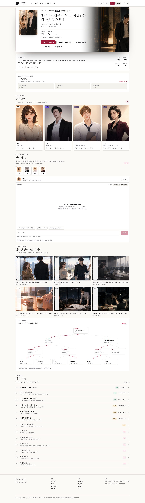 | 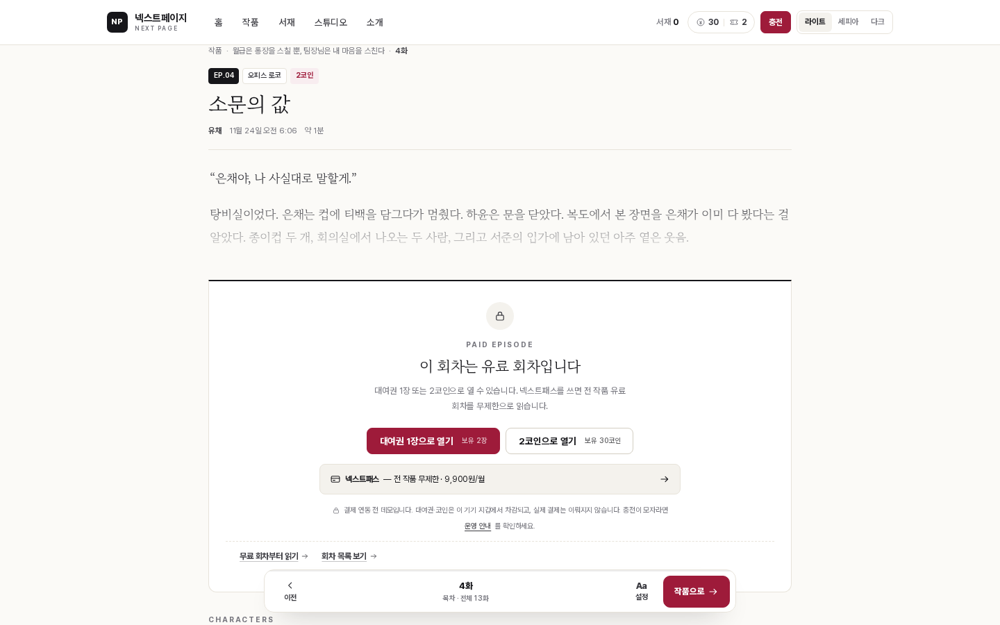 |

| 충전소 | 넥스트패스 | 모바일 홈 |
| --- | --- | --- |
| 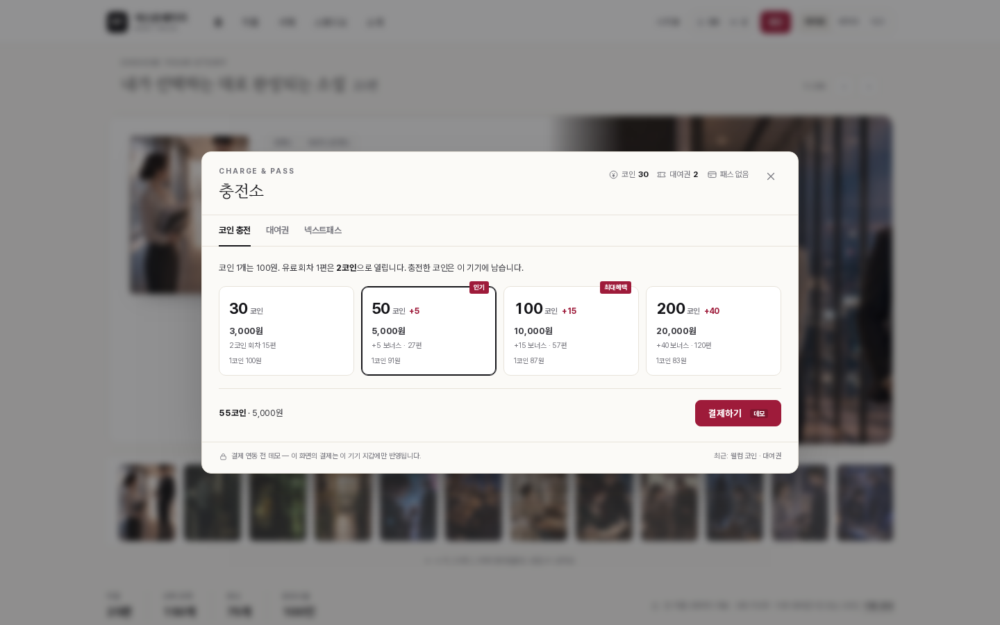 | 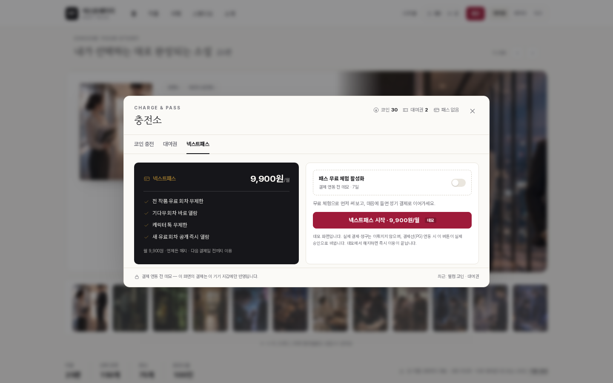 | 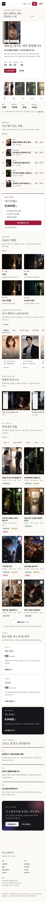 |

### 검증
- `npm run typecheck` · `npm run build` 통과
- `npm test` — **86개** (기존 69 + 유료 모델 로직 13 + 잠금/충전 화면 4)
- `npm run test:e2e` — **55개** (기존 52 + `e2e/pricing.spec.ts` 3)
- 화면 캡처: `node scripts/shots.mjs` — 개발 서버가 없으면 직접 띄워 `docs/screenshots/v9/`에 저장

---

## 0-1. 상용 고도화 (2026-11)

카카오페이지·리디북스·네이버시리즈 수준의 읽기 경험을 목표로, 콘텐츠와 리더기를 함께 손봤습니다.

### 콘텐츠 — 빈 곳을 닫았습니다
- **신작 10편 1화를 상용 연재 분량으로 개고** — 306~456자이던 1화를 **1,441~2,018자**(평균 1,570자)로 다시 썼습니다.
  장면 묘사·내적 독백·조연 대사·회차 말 훅을 넣어, 첫 화만 읽어도 다음 화를 누르게 만드는 분량입니다.
- **끊겨 있던 갈래 20개를 완결** — 1화에서 갈라지는 두 루트(`ep-*-2a`·`ep-*-2b`)를 1,220~1,539자로 집필해
  갈래마다 결말까지 닿습니다. 이제 25작품 모두 분기 지도에 '집필 중' 노드가 없습니다.
- **신작 10편에 독자 댓글 32개 시드** — 작품의 특정 문장·인물을 짚는 한 줄 댓글로, 빈 댓글란 대신 실제 독자 반응이 보입니다.
  독자가 쓰는 댓글·공감은 `np.comments.v1`에 이 기기 기준으로 저장됩니다.
- 기존 독자의 저장분은 **연재본이 더 길어지면 본문만 자동 교체**하고(내 댓글·투표·진행은 유지), 새 갈래 회차는 자동으로 추가됩니다.

### 리더기 — 읽기 설정 드로어
- 서체 3종(**본문 명조 / 깔끔 고딕 / 마루부리**), 글자 크기 슬라이더(15~28px), 줄간격 슬라이더(1.5~2.4배),
  배경 테마 3종(**화이트 / 세피아 / 다크 야간모드**)을 한 드로어에서 조절하고 `np.settings.v2`에 저장합니다.
- 모바일에서는 아래에서 올라오는 시트, 넓은 화면에서는 오른쪽 드로어로 열립니다(body 포털).
- 본문 도구 모음에는 자주 쓰는 테마·글자 크기 버튼만 남겨, 읽는 흐름을 끊지 않습니다.

### 내 서재 — 최근 본 · 찜 · 엔딩 도감 (`/shelf`)
- **최근 본 작품(이어보기)** — 회차를 읽으면 위치와 진행률이 남고, 홈과 서재에서 바로 이어 읽습니다(`np.reading.v2`).
- **내 서재(찜)** — 작품 카드의 ♡ 로 담고, 서재에서 한 번에 봅니다(`np.shelf.v1`).
- **엔딩 도감** — 작품별 엔딩 3개를 잠금/해제로 보여 주고, 아직 못 본 엔딩은 이름을 가립니다(`np.endings.v1`).
  작품 페이지에도 엔딩 수집 띠가 있습니다.

### 캐릭터 톡 — 호감도·기분·추천 대사
- 대화량·선택 수·소설에 넣은 대사로 **호감도(0~100)와 단계(낯섦→호기심→마음의 문→가까움→애틋함)**,
  지금 인물의 **기분 한 줄**을 보여 줍니다(이 기기에서만 계산).
- **추천 대사 3개**가 첫 대화·대화 중·선택 이후에 따라 달라집니다. 누르면 그대로 전송됩니다.
- `/api/chat` 실패를 **네트워크·시간 초과(12초)·혼잡(429)·서버·응답 파싱**으로 구분해 안내하고,
  기기 안 응답으로 답한 뒤 **「다시 시도」** 버튼을 제공합니다.

### 탐색 — 무드와 기획전
- 대표 장르 → 세부 태그에 이어 **무드 6종**(설렘 폭발 · 심장 찌릿 · 눈물 한 방울 · 웃음 보장 · 숨죽인 긴장 · 밤의 힐링)으로 거릅니다.
- 홈의 **오늘의 기획전**(로맨스 · 로판 · 오피스/현대물 · 미스터리/스릴러)과 작품 목록의 기획전 배너로 바로 들어갑니다.
- 모바일 우선: 하단 내비게이션 5탭(홈·작품·서재·스튜디오·소개), 읽기 화면 여백·터치 영역 조정.

### 검증
- `npm run typecheck` · `npm test` — **69개 검사 통과**(콘텐츠 분량·갈래 완결·댓글, 서재/엔딩 도감, 호감도·추천 대사, 무드/기획전, 저장분 마이그레이션, 화면 렌더).
- `npm run build` — Vite 프로덕션 빌드 통과.
- `npm run test:e2e` — 읽기 설정 저장, 최근 본·이어 읽기, 엔딩 도감, 찜 담기/빼기, 장면 대화, 엔딩 판정, 일러스트 로드.
  아주 작은 컨테이너(스레드 제한)에서는 `PW_LOW_RESOURCE=1 npm run test:e2e` 로 크로미움을 단일 프로세스로 띄웁니다.

---

## 1. 무엇이 들어 있나

### ⓪ ✨ 내가 선택하는 대로 완성되는 소설 (인터랙티브 모드)

홈 최상단의 **작품 선택 슬라이드**(25편)에서 시작합니다. 좌우 버튼·키보드(←/→)·드래그·썸네일로
작품을 넘기고, 슬라이드의 **「이 소설 시작하기」**를 누르면 플레이 화면(`/novel/:id/play`)으로 들어갑니다.

1. **화마다 2~3개의 갈래** — 대표작 5편은 22화, 나머지는 6화 뒤 100화까지. 고르는 즉시 결과 문단이 본문에 붙고,
   고른 갈래에 맞춘 이음 문단이 다음 장면 첫머리를 받아 줍니다.
2. **말 걸기 좋은 순간** — 아무 때나 뜨는 버튼이 아니라, 대화·대치·고백이 오가는 본문 문단 바로 뒤에
   말 걸기 지점이 붙습니다. **하고 싶은 말을 직접 타자로 쓰면** 그 자리에서 말이 걸리고(이 화 전용 힌트 3개는 보조), **행동 요약 한 문단과
   첫 대사가 그 자리에서 소설 본문으로** 들어갑니다(장면·선택·넣은 대사를 기억해 답하며, `/api/chat` Gemini,
   실패 시 기기 안 폴백). 이후 대사는 「이 대사 소설에 적용」으로 골라 담습니다.
3. **내 선택 기록** — 진행 바와 선택 타임라인. 지난 장면을 누르면 그 장면부터 다시 쓸 수 있습니다.
4. **내가 완성한 소설 읽기** (`/novel/:id/finale`) — 선택한 분기 본문 + 넣은 대사 + 도달한 엔딩이
   버튼·선택지 없이 한 편의 소설로 이어집니다. 마지막에 루트 요약(선택 수·적용 대사 수·엔딩명)과
   「다른 선택지로 다시 쓰기」·「처음부터 새로 쓰기」가 있습니다.

| 홈 작품 슬라이드 | 장면과 양자택일 | 장면 중간 캐릭터 톡 | 내가 완성한 소설 |
| --- | --- | --- | --- |
| 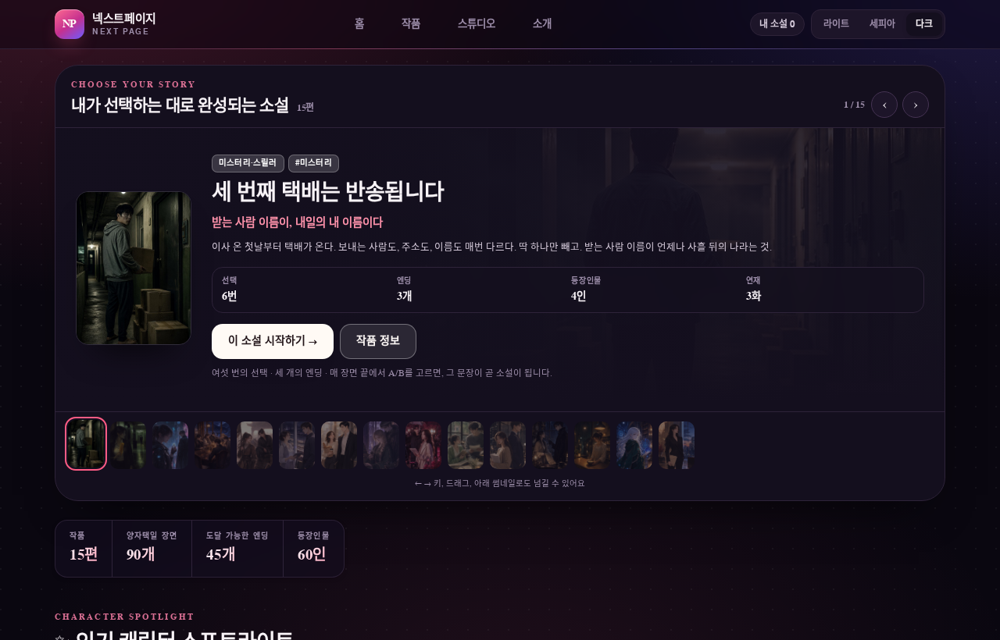 | 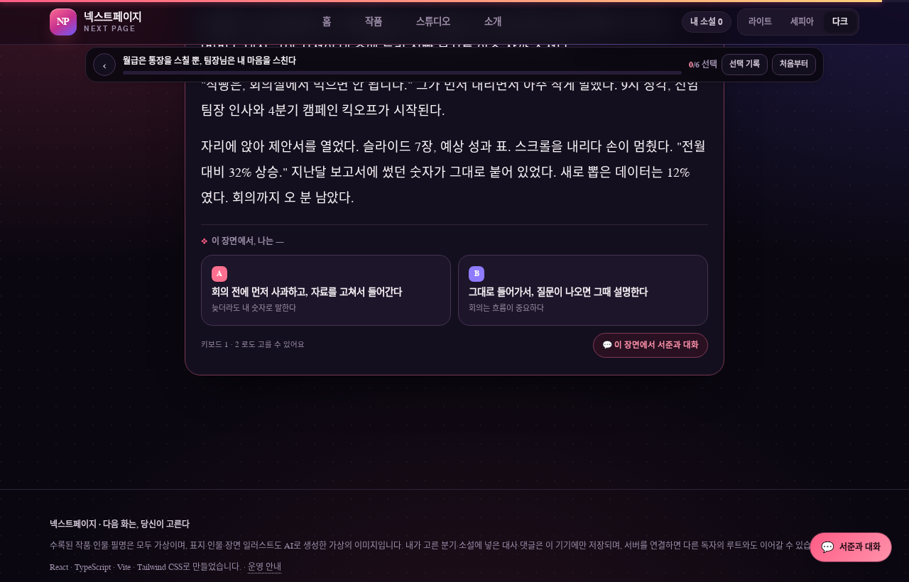 | 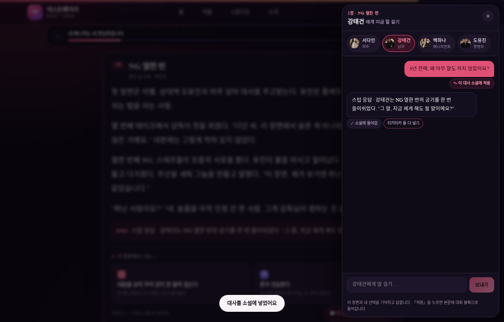 | 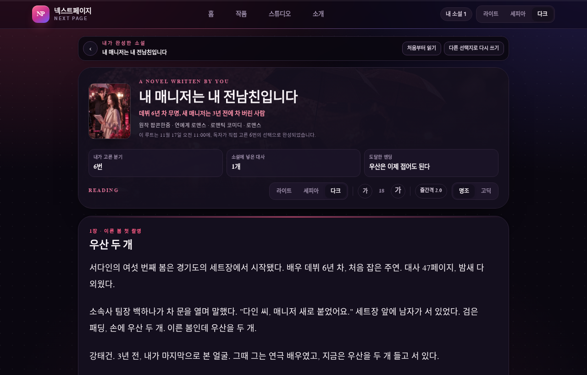 |

- 흐름 데이터는 `src/data/flows/`에 있고, 한 작품 = 6장면 × 3~4갈래 + 엔딩 3개(A/B/C)입니다.
  기존 15작품은 `flows/extras/`가 세 번째 갈래와 C 엔딩을 더하고, 신작 10편은 `data/stories/wave/`에
  작품·1화·흐름을 한 묶음으로 들어 있습니다.
- 진행·적용 대사는 `np.play.v1`, 장면 대화는 `np.scenechat.v1`로 이 기기에 저장됩니다.
- 기존의 회차 읽기·투표·분기 트리·작가 스튜디오는 그대로 남아 있고, 홈에서는 인터랙티브 모드가
  앞에 섭니다.

### ① 홈 · 히어로 + ✨ 캐릭터 스포트라이트
대표 작품의 키 비주얼을 깔고 블러 처리한 아트를 뒤에 두른 **히어로 배너**(실시간 투표 배지·TOP 1·등장인물 수·카운트다운),
그 아래로 **60명의 인물 카드를 가로로 훑는 캐릭터 스포트라이트**가 이어집니다.
카드에는 역할 배지(여주·남주·서브남주·라이벌·조력자…)와 한 줄 대사가 붙고, 대표 장르별로 걸러 볼 수 있으며,
카드를 누르면 그 인물이 나오는 작품의 등장인물 섹션으로 바로 이동합니다.

| 홈 (데스크톱) | 캐릭터 스포트라이트 |
| --- | --- |
|  | 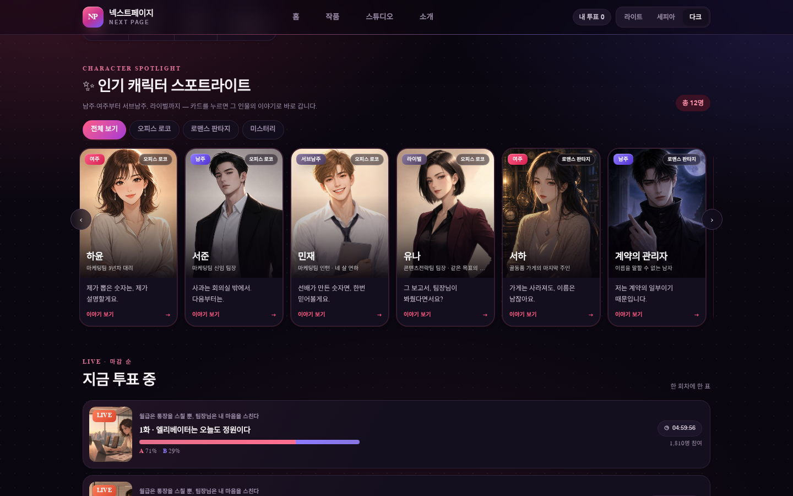 |

홈 아래로는 **지금 투표 중** 리스트, **🎨 명장면 일러스트** 가로 레일, 3:4 표지 피드가 이어집니다.
표지 카드에는 LIVE·HOT·D-day 배지, 장르 필, 참여자 수, 마감 카운트다운이 붙습니다.

| 모바일 홈 | 모바일 스포트라이트 |
| --- | --- |
|  | 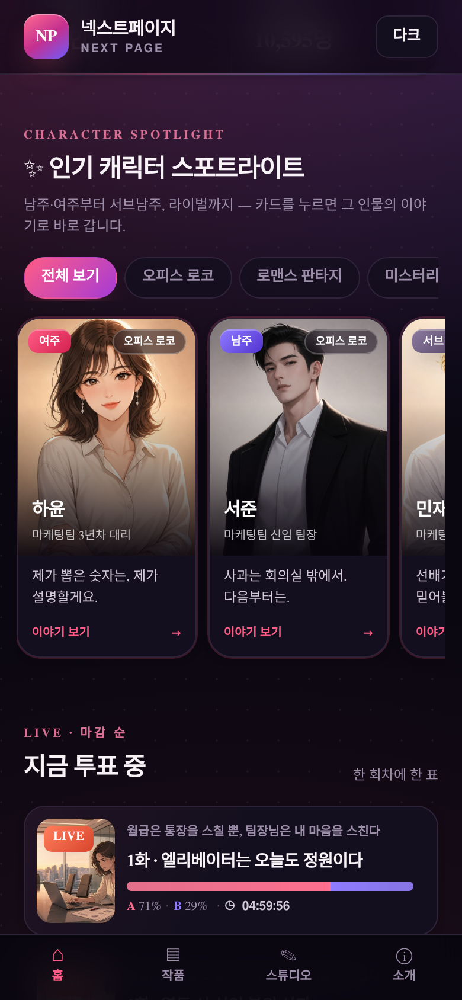 |

### ② 작품 페이지 · 키 비주얼 + 인물 포스터 + 💬 캐릭터 톡
표지를 크게 깔아 둔 작품 히어로, 시놉시스와 작품 정보, 그리고 **인물 포스터 카드 4장**이 있습니다.
인물 카드는 3:4 일러스트를 크게 깔고 역할 배지·이름·직함·대사를 붙여, 첫 화를 열기 전에 인물을 파악할 수 있습니다.
바로 아래 **💬 캐릭터 톡**에서 그 인물과 직접 대화할 수 있습니다.

| 작품 페이지 | 등장인물 포스터 | 캐릭터 톡 |
| --- | --- | --- |
|  |  | 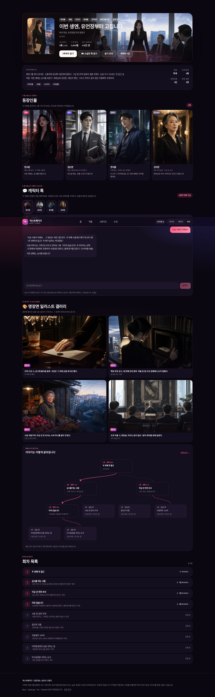 |

### 💬 캐릭터 톡 — 인물과 메신저 대화
작품의 남주·여주·라이벌을 골라 메신저처럼 대화합니다.

- **세계관·선택지 기억** : 현재 작품의 시놉시스, 지금까지 내가 고른 분기, 마지막으로 읽은 회차를
  프롬프트에 함께 보내, 인물이 "내 이야기"를 알고 답장합니다.
- **말투 유지** : 인물별 역할·대표 대사를 그대로 전달해, 성격이 답장에 남습니다.
- **AI 연결** : Vercel 배포에서는 `api/chat.ts` 서버리스 함수가 `GEMINI_API_KEY`
  (`gemini-3.5-flash-lite` 우선) → `OPENAI_API_KEY` 순으로 실시간 응답을 만듭니다.
- **키 없는 배포** : GitHub Pages 등 정적 호스팅에서는 `/api` 호출이 실패해도, 기기 안의
  상황 응답(폴백)이 같은 세계관·말투로 이어갑니다. 대화 기록은 이 기기에 저장됩니다.

### 📖 소설로 쭉 읽기 — 정주행 모드
회차 화면 상단·하단의 **`📖 소설로 쭉 읽기`** 버튼을 누르면, 선택지 버튼과 UI 장식 없이
내가 고른 분기가 **한 편의 웹소설 본문**으로 이어져 읽힙니다.

- 내가 투표한 선택지가 있으면 그쪽으로, 없으면 지금 다수파가 고른 루트로 이어집니다.
- 분기가 만나는 지점에는 조용한 구분선과 “내가 고른 길 / 다수파가 고른 길” 라벨만 놓습니다.
- 읽기 설정(글자 크기 15~26px, 줄간격 5단계, 명조/고딕, 라이트/세피아/다크)이 그대로 적용됩니다.
- 본문이 길 때는 **이어서 읽기**로 나눠 펼치고, 끝나면 마지막 회차에서 선택 모드로 복귀합니다.

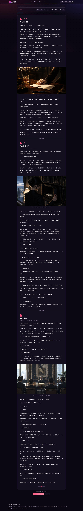

### ③ 🎨 명장면 일러스트 갤러리
회차 본문에 들어간 삽화를 작품 페이지에서 모아 봅니다. 카드를 누르면 원본 크기 **라이트박스**가 열리고,
그 장면이 나온 회차로 바로 들어갈 수 있습니다. (←/→ 로 넘기고 Esc 로 닫습니다)

| 갤러리 | 라이트박스 |
| --- | --- |
| 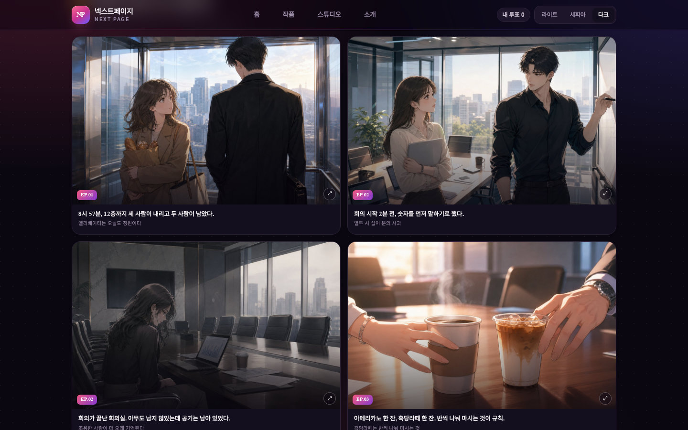 |  |

### ④ 몰입형 회차 뷰어 · 본문 삽화
- 본문은 명조 계열 서체, **글자 크기 15~26px** 조절, **라이트 / 세피아 / 다크** 3가지 테마.
  설정은 이 기기에 저장되어 다음 회차에서도 유지됩니다.
- 회차 중간중간 **본문 삽화**가 카드 폭을 꽉 채워 펼쳐집니다. 삽화 아래에는 장면을 요약한 한 줄 캡션이 붙습니다.
- 읽는 동안 화면 최상단에 **읽기 진행 게이지**가 채워지고, 회차 헤더에 예상 읽기 시간과 삽화 컷수가 표시됩니다.
- 회차 끝에서 **A/B VS 배틀 카드** → 선택 즉시 비율 막대가 애니메이션으로 채워지고
  “당신은 71% 다수파!” / “소수파!” 배지가 붙습니다.

| 회차 뷰어 | 본문 삽화 |
| --- | --- |
| 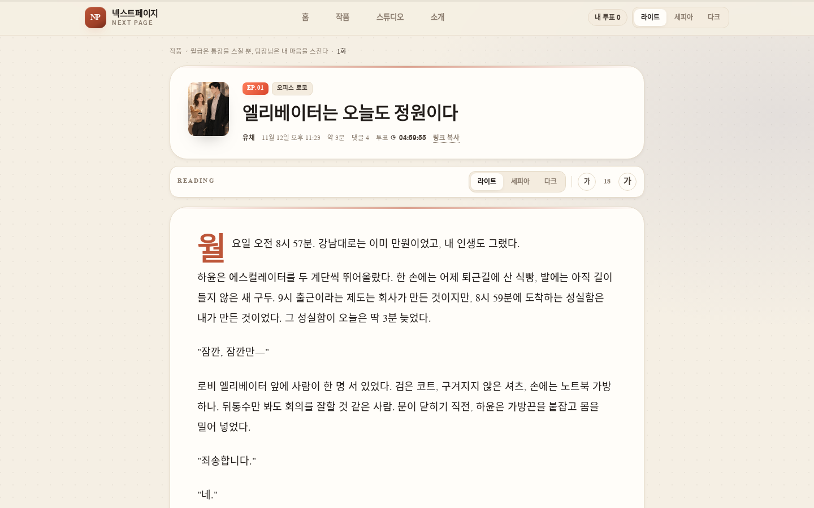 | 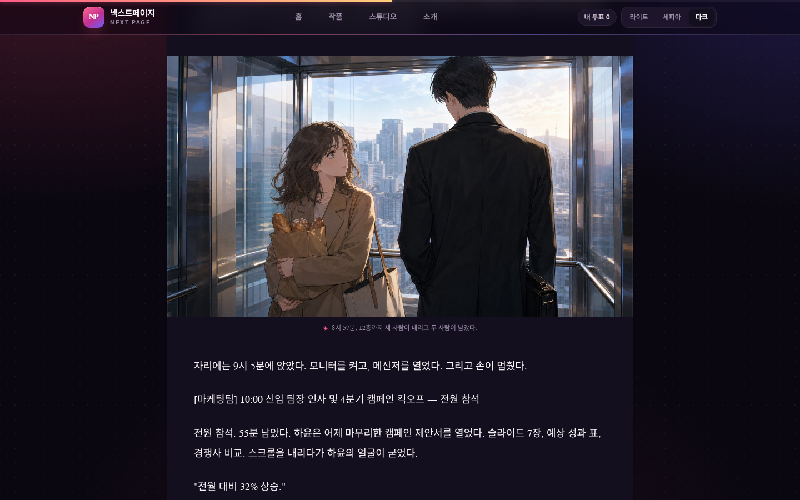 |

| 모바일 리더 | 모바일 삽화 |
| --- | --- |
|  |  |

### ⑤ A/B VS 배틀 카드
선택지 A는 **로즈**, 선택지 B는 **인디고**로 색을 갈라 두고, 각 카드에 그 선택을 고르면 이어질
**장면 일러스트**를 깔았습니다. 가운데 VS 메달, 선택 후에는 채택 루트 강조·퍼센트 리빌·득표 막대가 이어집니다.

| 투표 전 (VS) | 투표 후 (결과) |
| --- | --- |
|  |  |

| 모바일 투표 전 | 모바일 결과 |
| --- | --- |
|  | 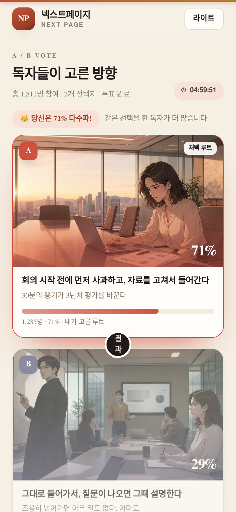 |

### ⑥ 결과 카드 공유 (1080×1920)
Canvas 2D로 스토리 규격 PNG를 만듭니다. 선택지 **장면 그림 + 표지 썸네일**을 함께 그려서
이미지 저장 / 클립보드 복사 / 회차 링크 복사가 가능합니다. (같은 출처 이미지라 캔버스가 오염되지 않습니다)


### ⑦ 분기 트리 시각화
1화 → 2화(채택 루트 / 미채택 루트) → 3화 흐름을 인터랙티브 SVG 노드 트리로 보여 줍니다.
부모 회차가 자식들의 가운데에 놓이도록 배치하고, **채택 루트는 굵은 실선**, 미채택은 가는 선,
아직 쓰이지 않은 회차는 점선 “집필 중”으로 구분합니다. 노드를 누르면 해당 회차로 이동합니다.


### ⑧ 작가 스튜디오
브라우저에서 바로 회차를 씁니다.

- **다음 화 슬롯 채우기** : 독자가 고른 루트에 예약된 빈 회차를 채웁니다(트리 연결 유지).
- **새 회차 추가** : 작품에 새 회차를 덧붙입니다.
- **새 작품 시작** : 작품 정보 + 1화를 한 번에 만듭니다.

발행하면 작품 피드 · 분기 트리 · 회차 목록에 **즉시 반영**되고, 회차 끝에 투표 카드가 열립니다.


### ⑨ 3가지 테마 (다크가 기본)
플랫폼 기본 화면은 옵시디언 플럼 다크. 읽기 화면에서는 포슬린 라이트와 종이 세피아를 고를 수 있습니다.
세 테마 모두 같은 디자인 토큰(표면·테두리·그림자·VS 색)을 공유합니다.

| 다크 (기본) | 라이트 리더 | 세피아 리더 |
| --- | --- | --- |
|  |  | 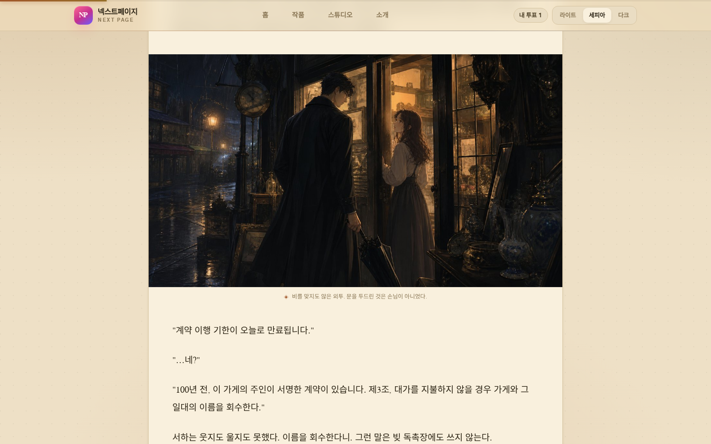 |

라이트 테마에서도 플랫폼 화면은 같은 로즈·인디고 포인트를 유지합니다.


### ⑩ 샘플 콘텐츠 25작품 (모두 가상)
바로 플레이할 수 있도록 **로맨스 중심 17편 + 다장르 8편, 스물다섯 작품**을 넣어 두었습니다.
2026 리뉴얼에서 20·30·40대 여성 독자를 기준으로 로맨스 10편(『대표님, 퇴사는 제가 결정합니다』,
『이혼 3년 차, 전남편이 옆집에 삽니다』, 『마흔의 봄, 스물여덟의 너』, 『악녀는 오늘도 야근을 한다』,
『버려진 공작부인은 온실을 가꾼다』, 『마탑의 계약서에 사인했습니다』, 『우리 다시, 연애부터 할까요』,
『옆집 남자는 새벽 두 시에 라면을 끓인다』, 『사장님, 그 계약 제가 다시 씁니다』,
『마법학교 조교는 퇴근하고 싶다』)을 더했습니다. 모든 작품·인물·필명·일러스트는 **가상**입니다.

작품 목록(`/library`)은 **대표 장르(로맨스·로맨스 판타지·판타지·무협·SF·미스터리·스릴러·오컬트·드라마·힐링)** 와 **세부 태그**의 2단 필터, 제목·필명·태그 검색, 최신·인기·제목 정렬을 제공합니다.

| 작품 | 필명 | 장르 | 구성 | 인물 |
| --- | --- | --- | --- | --- |
| 《월급은 통장을 스칠 뿐, 팀장님은 내 마음을 스친다》 | 유채 | 오피스 로코 | 1~3화 + 4화 예약, 2화부터 두 갈래 | 하윤·서준·민재·유나 |
| 《이 계약은 파기 불가입니다》 | 하루 | 로맨스 판타지 | 1~3화 + 4화 예약, 분기별 두 갈래 | 서하·관리자·카엘·비비안 |
| 《세 번째 택배는 반송됩니다》 | 윤슬 | 미스터리·스릴러 | 1~2화 + 3화 예약, 분기별 두 갈래 | 윤재·하린·수진·강실장 |
| 《이번 생엔, 유언장부터 고칩니다》 | 먹색 | 회귀·재벌 사이다 | 1~3화 + 4화 예약, 분기별 두 갈래 | 서린·도현·지훈·미란 |
| 《마법서고 4층에는 마녀가 산다》 | 새벽의서 | 판타지·이세계 마법 아카데미 | 1~3화 + 4화 예약, 분기별 두 갈래 | 리아·카이렌·세레나·무명 |
| 《새벽 두 시, 라면 한 그릇》 | 밤찻집 | 감성 힐링 드라마 | 1~3화 + 4화 예약, 분기별 두 갈래 | 소연·도현·명숙·태오 |
| 《3년 뒤, 이혼은 예약 완료》 | 이른봄 | 계약 결혼 로맨스 | 1~3화 + 4화 예약, 2화부터 두 갈래 | 지안·재현·문 실장·세라 |
| 《네 이름을 필기하는 시간》 | 초록연필 | 캠퍼스 청춘 로맨스 | 1~3화 + 4화 예약, 2화부터 두 갈래 | 유림·한결·수아·지호 |
| 《내 매니저는 내 전남친입니다》 | 팝콘한줌 | 연예계 비밀 연애 로코 | 1~3화 + 4화 예약, 2화부터 두 갈래 | 다인·태건·하나·유진 |
| 《폐하의 서고에서 퇴사합니다》 | 은제등잔 | 궁중 회귀 로맨스 판타지 | 1~3화 + 4화 예약, 2화부터 두 갈래 | 솔드·다리안·세리스·베아트리스 |
| 《그 팀은 저랑 상극입니다》 | 점심시간 | 혐관 사내 로맨스 | 1~3화 + 4화 예약, 2화부터 두 갈래 | 세영·시안·기훈·소미 |
| 《천리표국, 마지막 배송은 사람입니다》 | 청사 | 정통 무협 | 1~3화 + 4화 예약, 2화부터 두 갈래 | 연하·무진·설매·곽대수 |
| 《기억 보증 30일》 | 회로시인 | SF 사이버펑크 디스토피아 | 1~3화 + 4화 예약, 2화부터 두 갈래 | 백로·이안·메이·국장 |
| 《산장의 일곱 번째 의자》 | 겨울손님 | 심리 스릴러 밀실 추리 | 1~3화 + 4화 예약, 2화부터 두 갈래 | 지우·태섭·인아·만석 |
| 《우리 회사 3층에는 사람이 없습니다》 | 부적한장 | 현대 오컬트 오피스 코미디 | 1~3화 + 4화 예약, 2화부터 두 갈래 | 목단·하람·복실·3층 과장 |

**2026 리뉴얼 신작 10편** — 20·30·40대 여성 독자를 위한 로맨스 라인.

| 작품 | 필명 | 장르 | 인물 |
| --- | --- | --- | --- |
| 《대표님, 퇴사는 제가 결정합니다》 | 유월의서 | 오피스 로맨스·현대물 | 윤서아·강이든·박정후·오하린 |
| 《이혼 3년 차, 전남편이 옆집에 삽니다》 | 벽두칸 | 재회 로맨스·현대물 | 도하윤·지한결·김소리·윤태식 |
| 《마흔의 봄, 스물여덟의 너》 | 봄의온도 | 연하 로맨스·현대물 | 문하린·윤태오·김도담·오세훈 |
| 《악녀는 오늘도 야근을 한다》 | 금서고 | 로맨스 판타지·회귀 | 리아나·카이엔·마리·리안 |
| 《버려진 공작부인은 온실을 가꾼다》 | 온실지기 | 로판·계약 결혼·힐링 | 이레아·카일·톰·안나 |
| 《마탑의 계약서에 사인했습니다》 | 서고의밤 | 로판·계약·마법 | 세라·에단·벨·노아 |
| 《우리 다시, 연애부터 할까요》 | 장면번호 | 재회 로맨스·오피스 | 배수아·서도현·최유진·박정민 |
| 《옆집 남자는 새벽 두 시에 라면을 끓인다》 | 새벽냄비 | 힐링 로맨스·현대물 | 정하나·강민오·오미숙·두부 |
| 《사장님, 그 계약 제가 다시 씁니다》 | 제3조 | 계약 결혼·재벌 | 노유진·백재이·차현우·윤서아 |
| 《마법학교 조교는 퇴근하고 싶다》 | 정시퇴근 | 로판·아카데미·계약 | 리제·카일·티아·하르트 학장 |

**비주얼 자산 346점** — 표지 25 · 키 비주얼 25 · 인물 카드 100 · 선택지·본문 장면 196.
모두 AI로 생성한 가상의 이미지이며 `public/images/` 아래에 있습니다. 신작 10편도 표지·히어로·인물 4인·
1화 선택지·여섯 장면 컷을 모두 갖췄고, 작품 데이터의 그라데이션 표지는 그림이 늦게 뜰 때의 대체 화면으로 남겨 두었습니다.
장면 그림은 데이터의 `image` 가 비어 있을 때 `src/data/art-wave.ts` 의 `SCENE_ART` 가 id 로 붙입니다.

---

## 2. 기술 스택

| 구분 | 사용 |
| --- | --- |
| 코어 | React 19, TypeScript 5.9 (`strict`) |
| 빌드 | Vite 7 |
| 스타일 | Tailwind CSS 4 (`@tailwindcss/vite`) + CSS 변수 기반 3테마 디자인 토큰 |
| 라우팅 | React Router 7 (`HashRouter` — 정적 호스팅에서 새로고침 안전) |
| 시각화 | 의존성 없는 자체 SVG 트리 레이아웃 |
| 공유 카드 | Canvas 2D (1080×1920 PNG 생성, 표지·장면 이미지 합성) |
| 저장 | 브라우저 `localStorage` (저장소 인터페이스로 분리) |
| 캐릭터 톡 | Vercel Serverless (`api/chat.ts`) — Gemini `gemini-3.5-flash-lite` 우선, OpenAI 호환, 키 없으면 기기 안 상황 응답 |

외부 UI 라이브러리·아이콘 팩 없이 동작합니다. 본문 폰트(Pretendard·Noto Serif KR·MaruBuri)는
`src/assets/fonts/`에 자가 호스팅해 CDN 없이도 같은 서체로 보입니다. 일러스트는 `public/images/`에 정적 파일로 들어 있고,
화면에서는 `imageUrl()`(`src/data/art.ts`)을 거쳐 `base: './'` 기준 상대 경로로 불러옵니다.

---

## 3. 시작하기

```bash
npm install
npm run dev      # http://localhost:5173
npm run build    # 타입 검사 + 프로덕션 빌드 (dist/)
npm run preview  # 빌드 결과 확인

npm test         # 단위·화면 검사 (엔딩 일치·말 걸기 반영·대사 저장·조사 처리·데이터 린트)
npm run test:e2e # Playwright E2E (실제 브라우저에서 25작품 엔딩·말 걸기·조사)
npm run check    # 타입 → 단위 → 빌드 → E2E 순서로 전부
```

- Node 20 이상 권장 (`.nvmrc`: 22)
- `npm run build`는 `tsc --noEmit`을 먼저 실행하므로 타입 오류가 있으면 빌드가 멈춥니다.
- `npm test`는 브라우저 없이 돕니다(esbuild 번들 + `node:test` + jsdom). `npm run test:e2e`는 개발 서버를
  자동으로 띄운 뒤 Chromium으로 확인하므로, 처음 한 번은 `npx playwright install chromium`이 필요합니다.

## 4. GitHub Pages 배포

1. 이 저장소를 GitHub에 올립니다.
2. **Settings → Pages → Build and deployment → Source: GitHub Actions** 로 설정합니다.
3. `main` 브랜치에 푸시하면 `.github/workflows/deploy.yml`이 빌드·배포합니다.
4. `https://<사용자>.github.io/<저장소>/` 에서 열립니다.

`vite.config.ts`의 `base: './'`와 `HashRouter` 덕분에 하위 경로에서도 이미지·자산 경로가 깨지지 않고,
상세 회차 URL을 새로고침해도 404가 나지 않습니다.

### 💬 캐릭터 톡 AI 연결 (선택)

Vercel에 배포하면 `api/chat.ts`가 자동으로 서버리스 함수로 동작합니다(`maxDuration: 60`).
AI 답장을 켜려면 프로젝트 환경 변수에 키를 넣으세요.

```
GEMINI_API_KEY=...      # gemini-3.5-flash-lite (기본, GEMINI_MODEL 로 교체 가능)
OPENAI_API_KEY=...      # Gemini 키가 없을 때 사용 (OPENAI_MODEL 로 교체 가능)
```

키가 없어도 서비스는 그대로 동작합니다 — 캐릭터별 말투와 작품 맥락을 유지하는 기기 안
상황 응답으로 대화합니다. GitHub Pages 배포에서는 `/api`가 없어도 화면이 실패하지 않습니다.

`api/continue.ts`는 **장편 이어쓰기**용 함수입니다. 같은 Gemini/OpenAI 키를 쓰고, 독자가 고른 갈래·소설에 넣은 대사·직전 화 3개를 받아 다음 화(제목·장소·본문·다음 화 예고·갈래 2개)를 JSON으로 씁니다.
키가 없으면 `/api/continue`가 `{ chapter: null }`을 돌려주고, 화면은 **기기 안 집필**로 이어 씁니다(초안 표시).

---

## 5. 데이터 구조

```
Novel ─┬─ Episode ─┬─ Choice ─→ (targetEpisodeId)  ─┐
       │           │                                │  회차 = 트리의 노드
       │           └─ Comment                       │  선택지 = 간선
       └─ genres, penName, cover, coverImage, heroImage, characters

StoryFlow ─┬─ PlayScene ─┬─ PlayChoice (tone A/B/C, result, lead)
            │             ├─ cast[]        // 이 화에 실제로 있는 인물 id
            │             ├─ interaction   // 말 걸기 지점(힌트는 이 화 본문 대사에서 생성)
            │             └─ teaser        // 다음 화 예고
            ├─ parts[]                      // 장편 아크의 부(1부~4부)
            ├─ serial { target, premise[], beats[] }  // 이어쓰기 씨앗
            └─ endings[3]
```

- 장편 아크는 `src/data/flows/longform/`에 작품별로 두고, `applyLongform()`이 1부(6화) 뒤에 2~4부를 이어 붙입니다.
- `cast`가 비어 있으면 본문·제목·장소에 이름이 나오는 인물만 '이 화에 있는 사람'으로 계산하고, 서술자(독자의 화자)는 대화 상대에서 빠집니다.
- 이어쓴 화는 `localStorage: np.serial.v2`에 작품별로 쌓입니다(화 번호·본문·갈래·기억한 재료).

- `Episode.parentEpisodeId` 로 트리를 만들고, `Choice.targetEpisodeId` 로 간선을 긋습니다.
- 아직 쓰이지 않은 다음 화는 `status: 'pending'` 회차로 미리 만들어 두고, 스튜디오에서 채웁니다.
- 채택 루트는 별도 저장값이 아니라 **현재 득표 1위**로 계산합니다(투표가 바뀌면 루트 표시도 바뀝니다).
- 그림 경로는 `src/data/art.ts`에 모아 두고, 저장된 데이터에 없으면 id 기준으로 붙여 줍니다
  (`attachArt`) — 이전에 저장된 기기에서도 표지와 장면이 그대로 나타납니다.

### 본문 삽화 붙이는 법

```ts
// src/data/art.ts
export const EPISODE_SCENES: Record<string, InlineScene[]> = {
  'ep-office-1': [
    {
      image: 'images/scenes/story-office-1.jpg',
      caption: '8시 57분, 12층까지 세 사람이 내리고 두 사람이 남았다.',
      anchor: '그의 코트 자락이 복도 끝으로 사라졌다', // 이 문장이 있는 문단 뒤에 삽화
      fallbackAfter: 22, // 문단을 찾지 못하면 이 인덱스 뒤에
    },
  ],
}
```

`placeScenes()`가 문단 배열에 삽화 위치를 계산해 주고, 회차 뷰어는 그 자리에 `<figure class="inline-scene">`을
그립니다. 작품 페이지의 명장면 갤러리(`scenesForEpisodes()`)도 같은 데이터를 씁니다.

### 저장소 레이어

```ts
// src/lib/repository.ts
export interface NovelRepository {
  load(): Promise<Snapshot>
  saveEpisode(episode: Episode): Promise<void>
  addComment(comment: Comment): Promise<void>
  updateComment(comment: Comment): Promise<void>
  saveVote(vote: VoteRecord): Promise<void>
  saveSettings(settings: ReaderSettings): Promise<void>
  reset(): Promise<void>
}
```

기본 구현은 `LocalRepository`(이 기기 저장)입니다. 서버를 붙일 때는 `getRepository()`가 돌려주는
구현만 바꾸면 화면 코드는 그대로 동작합니다. Supabase 스키마와 RLS 예시는
[docs/BACKEND.md](docs/BACKEND.md)에 정리해 두었습니다.

> 현재 버전은 서버가 없으므로 **투표 집계는 기기별**입니다. 여러 독자가 같은 결과를 함께 보려면
> 백엔드 연결이 필요합니다(로드맵 1번).

---

## 6. 폴더 구조

```
src/
├─ components/     Layout, HeroBanner, NovelCard, CharacterStrip, CharacterSpotlight,
│                  SceneGallery, VotePanel, ChoiceBattleCard, ShareCardModal, BranchTree,
│                  CommentSection, ReaderToolbar, ReaderSettingsDrawer, ReadingProgress, Countdown,
│                  StoryMode(정주행), CharacterChat, CharacterTalkSection,
│                  Icon(선 아이콘), PricingModal(충전소), EpisodeLock(유료 회차 안내)
├─ pages/          Home, Library, Shelf(서재·엔딩 도감), Novel, Episode, Tree, Studio, About, Play, Finale, StoryModePage
├─ store/          StoreProvider (상태 + 저장소 연결)
├─ lib/            repository, vote(집계), tree(레이아웃), story(정주행 경로), chat(톡 유틸),
│                  library(최근 본·찜·엔딩 도감), play(분기 진행·완성본),
│                  commerce(코인·대여권·넥스트패스 정책과 지갑), format, share-card(캔버스)
├─ data/seed.ts    샘플 작품 25편 (본문·선택지·댓글) — 신작은 data/stories/ 로 분리
│                  (2026 리뉴얼 신작 10편은 data/stories/wave/, 정식 연재본·갈래 회차는 wave/deep/)
├─ data/art.ts     일러스트 인덱스 · 본문 삽화 위치 + 경로 해석
├─ data/art-wave.ts 신작 10편 표지·히어로·인물 40인·장면 106컷 인덱스
├─ lib/genres.ts   대표 장르 그룹 · 세부 태그 · 무드 · 기획전 · 검색 매칭
├─ index.css       스타일 진입점 (tailwind → legacy → editorial → screens)
├─ styles/legacy.css     기존 화면 스타일 (구조)
├─ styles/editorial.css  v8 디자인 토큰 · 홈 · 회차 · 충전소
├─ styles/screens.css    v8 안쪽 화면(서재·플레이·말 걸기) 정리
└─ types.ts        도메인 타입
api/
└─ chat.ts         캐릭터 톡 서버리스 함수 (Vercel)
public/images/
├─ covers/         작품 표지 25종 + 키 비주얼 25종
├─ characters/     인물 카드 100종
└─ scenes/         선택지·장면 컷 196종 + 본문 삽화
tests/              단위·화면 검사 (25작품 엔딩 일치 · 말 걸기 반영 · 조사 · 데이터 린트 ·
                    콘텐츠 분량·갈래 완결 · 서재/엔딩 도감 · 호감도/추천 대사 · 저장분 마이그레이션)
e2e/                Playwright E2E (25작품 엔딩 · 말 걸기 · 조사 · 일러스트 전수 로드 ·
                    읽기 설정 저장 · 최근 본/이어 읽기 · 엔딩 도감 · 찜 · 유료 회차/충전/패스)
scripts/
├─ test-unit.mjs    단위·화면 검사 실행기
├─ story-audit.ts   스토리라인 전수 감사 (분기 목표·도달성·순환·연속성)
├─ ux-audit.mjs     독자 여정 캡처·계측 (데스크톱 1440 / 모바일 390)
├─ ux-flow.mjs      투표→다음 화·잠금·더 보기 상호작용 점검
└─ shots.mjs        화면 캡처 (docs/screenshots/v9)
docs/
├─ BACKEND.md      Supabase 스키마 · 저장소 매핑
├─ screenshots/    README 이미지 (1차)
├─ screenshots-v2/ 다장르·정주행·캐릭터 톡 화면 이미지
├─ screenshots/v8/ v8 편집 디자인 · 유료 회차 · 충전소 화면
└─ screenshots/v9/ v9 리더 하단 바 · 홈 더 보기 · 잠금 탈출 동선
```

---

## 7. 로드맵

1. **Supabase 연결** — 계정 없는 익명 세션(`auth.signInAnonymously()`)으로 기기당 1표, 실시간 집계 구독.
2. **마감 자동화** — 마감 시각에 1위 루트를 확정하고 다음 화 슬롯을 여는 스케줄러(Edge Function / cron).
3. **작가 인증** — 필명 소유권, 회차 수정 이력, 신고 처리.
4. **투표 알림** — 내가 참여한 회차의 결과 확정 알림.
5. **OG 이미지** — 회차 링크 공유 시 결과 카드가 미리보기로 뜨도록 서버 측 렌더링.
6. **스튜디오 일러스트 업로드** — 선택지·본문 삽화를 직접 올려 장면 카드를 채우기.
7. **캐릭터 톡 기억 강화** — 작품 전체 분기 트리를 벡터로 요약해 인물의 장기 기억으로.

## 8. 라이선스 · 고지

- 코드: [MIT License](LICENSE)
- 수록된 작품·인물·필명은 모두 **가상**이며 실제 인물·단체와 무관합니다.
- 표지·인물·장면 일러스트는 AI로 생성한 가상의 이미지입니다.
- 폰트: Pretendard(SIL Open Font License 1.1) · Noto Serif KR(SIL OFL 1.1) ·
  MaruBuri(네이버 한글한글아름답게, SIL OFL 1.1) — 모두 `src/assets/fonts/`에 자가 호스팅합니다.
- 실제 인물의 이름·연락처·계정·결제 정보는 데이터와 화면에 넣지 않았습니다. 캐릭터 대화에 쓰이는
  AI 키는 서버 환경변수(`GEMINI_API_KEY`/`OPENAI_API_KEY`)로만 읽고, 클라이언트 번들에 포함하지 않습니다.
