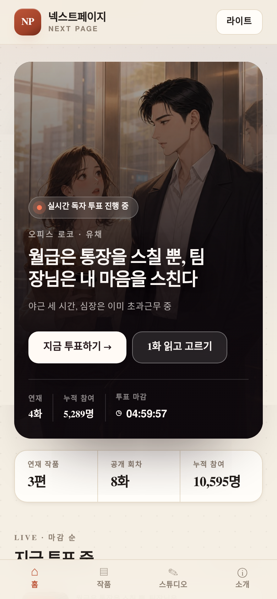
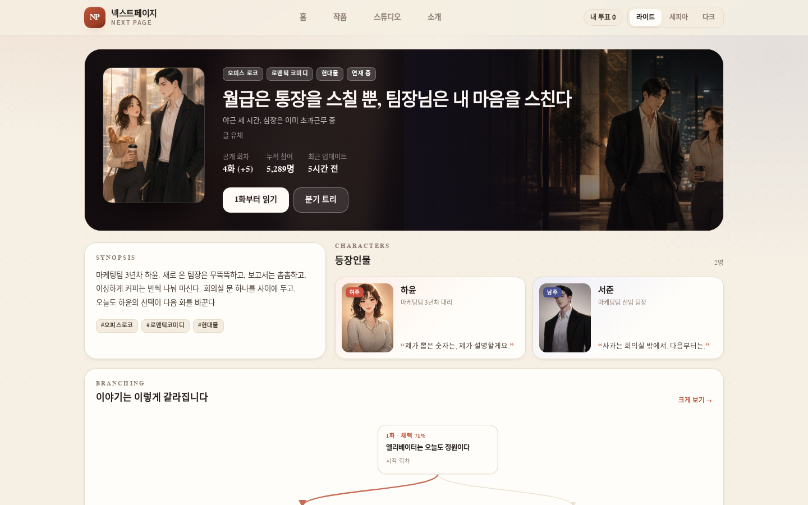
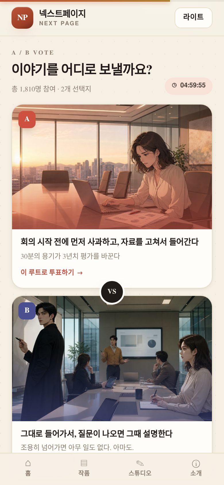
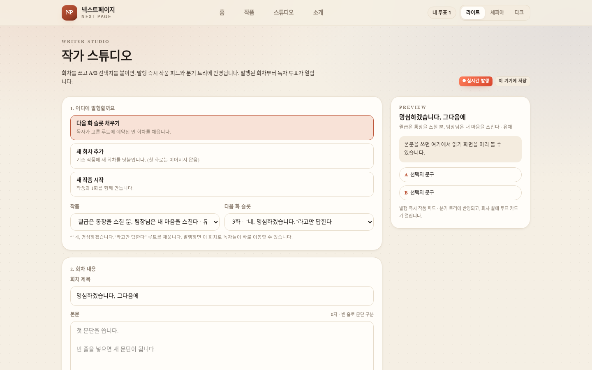

# 넥스트페이지 (Next Page)

> **다음 화는, 당신이 고른다.**
> 회차 끝에서 독자가 A/B를 고르고, 다수파가 고른 루트로 이야기가 이어지는 **선택형(브랜칭) 웹소설 플랫폼**입니다.


웹소설을 읽는 일은 원래 일방향입니다. 작가가 쓰고, 독자는 따라갑니다.
넥스트페이지는 그 방향을 한 번 뒤집습니다. 회차가 끝나는 지점마다 두 갈래의 선택지가 열리고,
독자는 **한 표**로 다음 화의 방향을 정합니다. 선택지에는 장면 일러스트가 붙어, 글로만 고르는 대신
**그림을 보고 고르는** 재미가 생깁니다. 결과는 즉시 공개되고, 내 선택이 다수파인지 소수파인지 알려 줍니다.
결과는 인스타그램 스토리 규격(1080×1920) 카드로 저장·공유할 수 있습니다.

- 데모 : `npm install && npm run dev`
- 배포 : GitHub Pages 워크플로 포함 (`.github/workflows/deploy.yml`)

---

## 1. 무엇이 들어 있나

### ① 홈 · 히어로 + 표지 갤러리
대표 작품의 키 비주얼을 깔아 둔 **히어로 배너**(실시간 투표 배지·카운트다운·표지 카드)와,
실제 웹소설 플랫폼처럼 **3:4 표지 카드**로 구성한 작품 피드가 있습니다.
카드에는 LIVE·HOT·D-day 배지, 장르 필, 참여자 수, 마감 카운트다운이 붙고, 호버하면 표지가 살짝 확대됩니다.

| 홈 (데스크톱) | 홈 (모바일) |
| --- | --- |
|  |  |

### ② 작품 페이지 · 표지 + 등장인물
표지를 크게 깔아 둔 작품 히어로, 시놉시스, 그리고 **등장인물 카드 스트립**이 있습니다.
인물 카드에는 남주/여주 배지와 한 줄 대사가 붙어, 첫 화를 열기 전에 인물을 파악할 수 있습니다.

| 작품 페이지 | 등장인물 스트립 |
| --- | --- |
|  |  |

### ③ 몰입형 회차 뷰어
- 본문은 명조 계열 서체, **글자 크기 15~26px** 조절, **라이트 / 세피아 / 다크** 3가지 테마.
  설정은 이 기기에 저장되어 다음 회차에서도 유지됩니다.
- 읽는 동안 화면 최상단에 **읽기 진행 게이지**가 채워지고, 회차 헤더에 예상 읽기 시간이 표시됩니다.
- 회차 끝에서 **A/B VS 배틀 카드** → 선택 즉시 비율 막대가 애니메이션으로 채워지고
  “당신은 71% 다수파!” / “소수파!” 배지가 붙습니다.


### ④ A/B VS 배틀 카드
선택지 A는 **로즈**, 선택지 B는 **인디고**로 색을 갈라 두고, 각 카드에 그 선택을 고르면 이어질
**장면 일러스트**를 깔았습니다. 가운데 VS 메달, 선택 후에는 채택 루트 강조·퍼센트 리빌·득표 막대가 이어집니다.

| 투표 전 (VS) | 투표 후 (결과) |
| --- | --- |
|  |  |

| 모바일 투표 전 | 모바일 결과 |
| --- | --- |
|  |  |

### ⑤ 결과 카드 공유 (1080×1920)
Canvas 2D로 스토리 규격 PNG를 만듭니다. 선택지 **장면 그림 + 표지 썸네일**을 함께 그려서
이미지 저장 / 클립보드 복사 / 회차 링크 복사가 가능합니다. (같은 출처 이미지라 캔버스가 오염되지 않습니다)


### ⑥ 분기 트리 시각화
1화 → 2화(채택 루트 / 미채택 루트) → 3화 흐름을 인터랙티브 SVG 노드 트리로 보여 줍니다.
부모 회차가 자식들의 가운데에 놓이도록 배치하고, **채택 루트는 굵은 실선**, 미채택은 가는 선,
아직 쓰이지 않은 회차는 점선 “집필 중”으로 구분합니다. 노드를 누르면 해당 회차로 이동합니다.


### ⑦ 작가 스튜디오
브라우저에서 바로 회차를 씁니다.

- **다음 화 슬롯 채우기** : 독자가 고른 루트에 예약된 빈 회차를 채웁니다(트리 연결 유지).
- **새 회차 추가** : 작품에 새 회차를 덧붙입니다.
- **새 작품 시작** : 작품 정보 + 1화를 한 번에 만듭니다.

발행하면 작품 피드 · 분기 트리 · 회차 목록에 **즉시 반영**되고, 회차 끝에 투표 카드가 열립니다.



### ⑧ 3가지 테마
라이트 / 세피아 / 다크 모두 같은 디자인 토큰(표면·테두리·그림자·VS 색)을 공유합니다.


### ⑨ 샘플 콘텐츠 (모두 가상)
바로 플레이할 수 있도록 세 작품을 넣어 두었습니다. 모든 작품·인물·필명·일러스트는 **가상**입니다.

| 작품 | 필명 | 구성 | 일러스트 |
| --- | --- | --- | --- |
| 《월급은 통장을 스칠 뿐, 팀장님은 내 마음을 스친다》 (오피스 로코) | 유채 | 1~3화 + 4화 예약, 2화부터 두 갈래 | 표지·히어로·남녀 주인공·장면 8컷 |
| 《이 계약은 파기 불가입니다》 (로맨스 판타지) | 하루 | 1~2화, 1화에서 두 갈래 | 표지·주인공 2인·장면 6컷 |
| 《세 번째 택배는 반송됩니다》 (미스터리) | 윤슬 | 1화 + 2화 두 갈래 집필 중 | 표지·주인공·장면 2컷 |

---

## 2. 기술 스택

| 구분 | 사용 |
| --- | --- |
| 코어 | React 19, TypeScript 5.9 (`strict`) |
| 빌드 | Vite 7 |
| 스타일 | Tailwind CSS 4 (`@tailwindcss/vite`) + CSS 변수 기반 3테마 디자인 토큰 |
| 라우팅 | React Router 7 (`HashRouter` — 정적 호스팅에서 새로고침 안전) |
| 시각화 | 의존성 없는 자체 SVG 트리 레이아웃 |
| 공유 카드 | Canvas 2D (1080×1920 PNG 생성, 표지·장면 이미지 합성) |
| 저장 | 브라우저 `localStorage` (저장소 인터페이스로 분리) |

외부 UI 라이브러리·아이콘 팩·폰트 CDN 없이 동작합니다. 일러스트는 `public/images/`에 정적 파일로 들어 있고,
화면에서는 `imageUrl()`(`src/data/art.ts`)을 거쳐 `base: './'` 기준 상대 경로로 불러옵니다.

---

## 3. 시작하기

```bash
npm install
npm run dev      # http://localhost:5173
npm run build    # 타입 검사 + 프로덕션 빌드 (dist/)
npm run preview  # 빌드 결과 확인
```

- Node 20 이상 권장 (`.nvmrc`: 22)
- `npm run build`는 `tsc --noEmit`을 먼저 실행하므로 타입 오류가 있으면 빌드가 멈춥니다.

## 4. GitHub Pages 배포

1. 이 저장소를 GitHub에 올립니다.
2. **Settings → Pages → Build and deployment → Source: GitHub Actions** 로 설정합니다.
3. `main` 브랜치에 푸시하면 `.github/workflows/deploy.yml`이 빌드·배포합니다.
4. `https://<사용자>.github.io/<저장소>/` 에서 열립니다.

`vite.config.ts`의 `base: './'`와 `HashRouter` 덕분에 하위 경로에서도 이미지·자산 경로가 깨지지 않고,
상세 회차 URL을 새로고침해도 404가 나지 않습니다.

---

## 5. 데이터 구조

```
Novel ─┬─ Episode ─┬─ Choice ─→ (targetEpisodeId)  ─┐
       │           │                                │  회차 = 트리의 노드
       │           └─ Comment                       │  선택지 = 간선
       └─ genres, penName, cover, coverImage, characters
```

- `Episode.parentEpisodeId` 로 트리를 만들고, `Choice.targetEpisodeId` 로 간선을 긋습니다.
- 아직 쓰이지 않은 다음 화는 `status: 'pending'` 회차로 미리 만들어 두고, 스튜디오에서 채웁니다.
- 채택 루트는 별도 저장값이 아니라 **현재 득표 1위**로 계산합니다(투표가 바뀌면 루트 표시도 바뀝니다).
- 그림 경로는 `src/data/art.ts`에 모아 두고, 저장된 데이터에 없으면 id 기준으로 붙여 줍니다
  (`attachArt`) — 이전에 저장된 기기에서도 표지와 장면이 그대로 나타납니다.

### 저장소 레이어

```ts
// src/lib/repository.ts
export interface NovelRepository {
  load(): Promise<Snapshot>
  saveEpisode(episode: Episode): Promise<void>
  addComment(comment: Comment): Promise<void>
  updateComment(comment: Comment): Promise<void>
  saveVote(vote: VoteRecord): Promise<void>
  saveSettings(settings: ReaderSettings): Promise<void>
  reset(): Promise<void>
}
```

기본 구현은 `LocalRepository`(이 기기 저장)입니다. 서버를 붙일 때는 `getRepository()`가 돌려주는
구현만 바꾸면 화면 코드는 그대로 동작합니다. Supabase 스키마와 RLS 예시는
[docs/BACKEND.md](docs/BACKEND.md)에 정리해 두었습니다.

> 현재 버전은 서버가 없으므로 **투표 집계는 기기별**입니다. 여러 독자가 같은 결과를 함께 보려면
> 백엔드 연결이 필요합니다(로드맵 1번).

---

## 6. 폴더 구조

```
src/
├─ components/     Layout, HeroBanner, NovelCard, CharacterStrip, VotePanel, ChoiceBattleCard,
│                  ShareCardModal, BranchTree, CommentSection, ReaderToolbar, ReadingProgress, Countdown
├─ pages/          Home, Library, Novel, Episode, Tree, Studio, About
├─ store/          StoreProvider (상태 + 저장소 연결)
├─ lib/            repository, vote(집계), tree(레이아웃), format, share-card(캔버스)
├─ data/seed.ts    샘플 작품 3편 (본문·선택지·댓글)
├─ data/art.ts     일러스트 인덱스 + 경로 해석
├─ index.css       디자인 토큰(3테마) · 컴포넌트 스타일
└─ types.ts        도메인 타입
public/images/
├─ covers/         작품 표지 3종 + 히어로 키 비주얼
├─ characters/     인물 카드 5종
└─ scenes/         선택지 장면 16컷
docs/
├─ BACKEND.md      Supabase 스키마 · 저장소 매핑
└─ screenshots/    README 이미지
```

---

## 7. 로드맵

1. **Supabase 연결** — 계정 없는 익명 세션(`auth.signInAnonymously()`)으로 기기당 1표, 실시간 집계 구독.
2. **마감 자동화** — 마감 시각에 1위 루트를 확정하고 다음 화 슬롯을 여는 스케줄러(Edge Function / cron).
3. **작가 인증** — 필명 소유권, 회차 수정 이력, 신고 처리.
4. **투표 알림** — 내가 참여한 회차의 결과 확정 알림.
5. **OG 이미지** — 회차 링크 공유 시 결과 카드가 미리보기로 뜨도록 서버 측 렌더링.
6. **스튜디오 일러스트 업로드** — 선택지마다 그림을 올려 장면 카드를 직접 채우기.

## 8. 라이선스 · 고지

- 코드: [MIT License](LICENSE)
- 수록된 작품·인물·필명은 모두 **가상**이며 실제 인물·단체와 무관합니다.
- 표지·인물·장면 일러스트는 AI로 생성한 가상의 이미지입니다.
