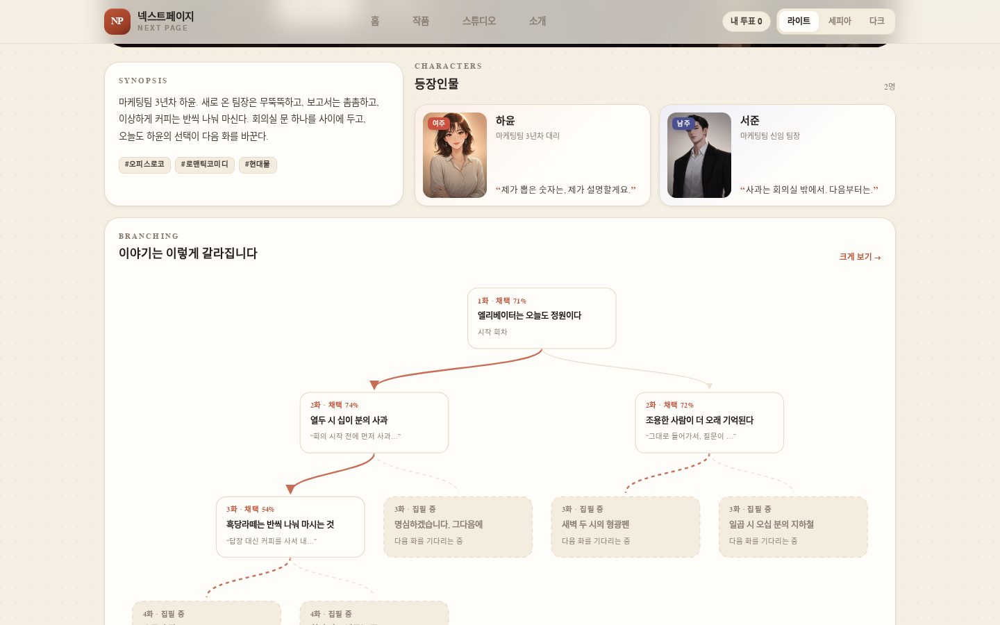
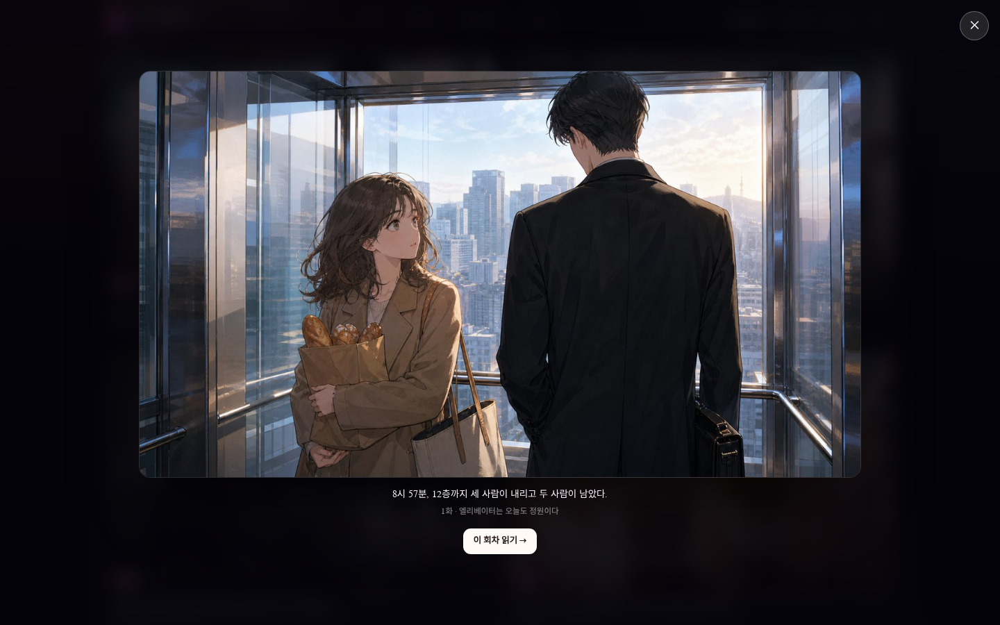
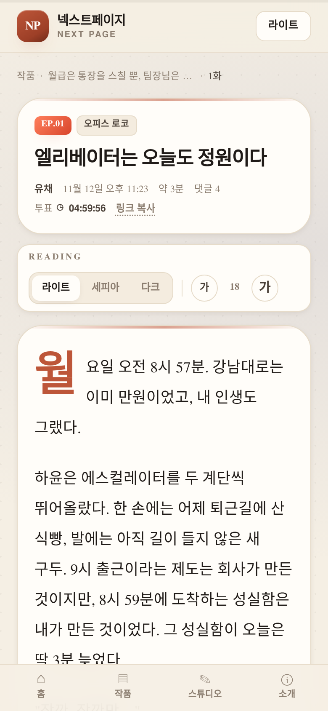
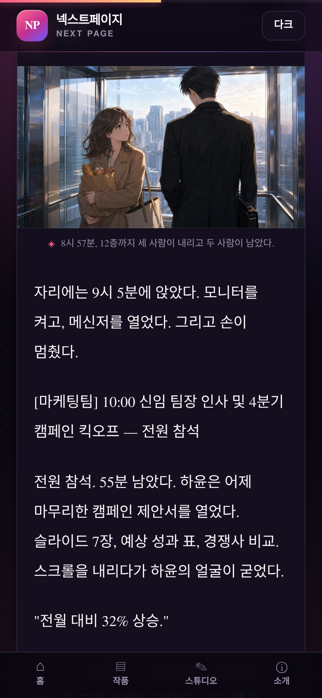
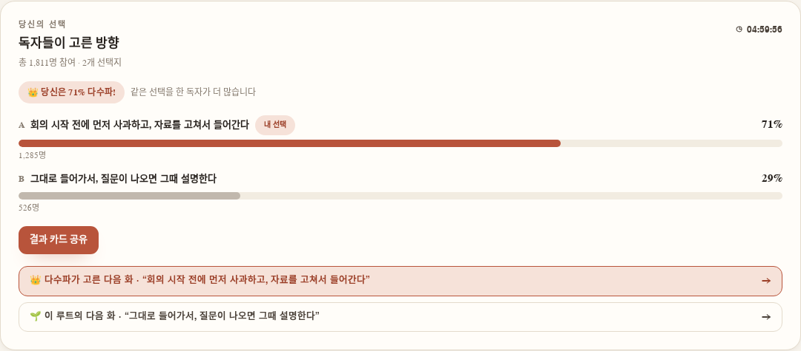
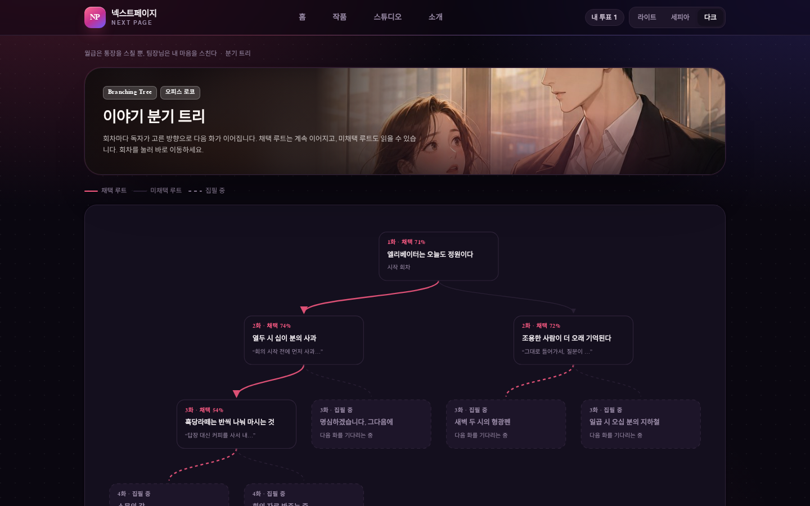
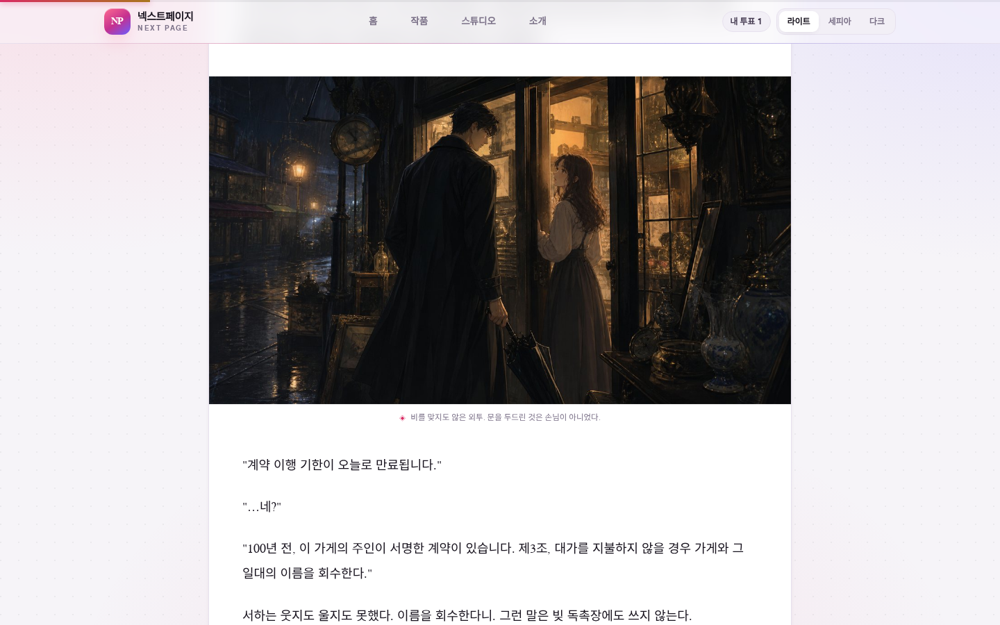

# 넥스트페이지 (Next Page)

> **다음 화는, 당신이 고른다.**
> 회차 끝에서 독자가 A/B를 고르고, 다수파가 고른 루트로 이야기가 이어지는 **선택형(브랜칭) 웹소설 플랫폼**입니다.


웹소설을 읽는 일은 원래 일방향입니다. 작가가 쓰고, 독자는 따라갑니다.
넥스트페이지는 그 방향을 한 번 뒤집습니다. 회차가 끝나는 지점마다 두 갈래의 선택지가 열리고,
독자는 **한 표**로 다음 화의 방향을 정합니다. 선택지에는 장면 일러스트가 붙어, 글로만 고르는 대신
**그림을 보고 고르는** 재미가 생깁니다. 결과는 즉시 공개되고, 내 선택이 다수파인지 소수파인지 알려 줍니다.
결과는 인스타그램 스토리 규격(1080×1920) 카드로 저장·공유할 수 있습니다.

화면은 **옵시디언 플럼 바탕에 일렉트릭 로즈·인디고 바이올렛**을 얹은 다크 테마로 시작하고,
읽기 화면에서는 라이트·세피아·다크를 골라 쓸 수 있습니다.

- 데모 : `npm install && npm run dev`
- 배포 : GitHub Pages 워크플로 포함 (`.github/workflows/deploy.yml`)

---

## 1. 무엇이 들어 있나

### ① 홈 · 히어로 + ✨ 캐릭터 스포트라이트
대표 작품의 키 비주얼을 깔고 블러 처리한 아트를 뒤에 두른 **히어로 배너**(실시간 투표 배지·TOP 1·등장인물 수·카운트다운),
그 아래로 **60명의 인물 카드를 가로로 훑는 캐릭터 스포트라이트**가 이어집니다.
카드에는 역할 배지(여주·남주·서브남주·라이벌·조력자…)와 한 줄 대사가 붙고, 대표 장르별로 걸러 볼 수 있으며,
카드를 누르면 그 인물이 나오는 작품의 등장인물 섹션으로 바로 이동합니다.

| 홈 (데스크톱) | 캐릭터 스포트라이트 |
| --- | --- |
|  |  |

홈 아래로는 **지금 투표 중** 리스트, **🎨 명장면 일러스트** 가로 레일, 3:4 표지 피드가 이어집니다.
표지 카드에는 LIVE·HOT·D-day 배지, 장르 필, 참여자 수, 마감 카운트다운이 붙습니다.

| 모바일 홈 | 모바일 스포트라이트 |
| --- | --- |
|  |  |

### ② 작품 페이지 · 키 비주얼 + 인물 포스터 + 💬 캐릭터 톡
표지를 크게 깔아 둔 작품 히어로, 시놉시스와 작품 정보, 그리고 **인물 포스터 카드 4장**이 있습니다.
인물 카드는 3:4 일러스트를 크게 깔고 역할 배지·이름·직함·대사를 붙여, 첫 화를 열기 전에 인물을 파악할 수 있습니다.
바로 아래 **💬 캐릭터 톡**에서 그 인물과 직접 대화할 수 있습니다.

| 작품 페이지 | 등장인물 포스터 | 캐릭터 톡 |
| --- | --- | --- |
|  |  |  |

### 💬 캐릭터 톡 — 인물과 메신저 대화
작품의 남주·여주·라이벌을 골라 메신저처럼 대화합니다.

- **세계관·선택지 기억** : 현재 작품의 시놉시스, 지금까지 내가 고른 분기, 마지막으로 읽은 회차를
  프롬프트에 함께 보내, 인물이 "내 이야기"를 알고 답장합니다.
- **말투 유지** : 인물별 역할·대표 대사를 그대로 전달해, 성격이 답장에 남습니다.
- **AI 연결** : Vercel 배포에서는 `api/chat.ts` 서버리스 함수가 `GEMINI_API_KEY`
  (`gemini-3.5-flash-lite` 우선) → `OPENAI_API_KEY` 순으로 실시간 응답을 만듭니다.
- **키 없는 배포** : GitHub Pages 등 정적 호스팅에서는 `/api` 호출이 실패해도, 기기 안의
  상황 응답(폴백)이 같은 세계관·말투로 이어갑니다. 대화 기록은 이 기기에 저장됩니다.

### 📖 소설로 쭉 읽기 — 정주행 모드
회차 화면 상단·하단의 **`📖 소설로 쭉 읽기`** 버튼을 누르면, 선택지 버튼과 UI 장식 없이
내가 고른 분기가 **한 편의 웹소설 본문**으로 이어져 읽힙니다.

- 내가 투표한 선택지가 있으면 그쪽으로, 없으면 지금 다수파가 고른 루트로 이어집니다.
- 분기가 만나는 지점에는 조용한 구분선과 “내가 고른 길 / 다수파가 고른 길” 라벨만 놓습니다.
- 읽기 설정(글자 크기 15~26px, 줄간격 5단계, 명조/고딕, 라이트/세피아/다크)이 그대로 적용됩니다.
- 본문이 길 때는 **이어서 읽기**로 나눠 펼치고, 끝나면 마지막 회차에서 선택 모드로 복귀합니다.


### ③ 🎨 명장면 일러스트 갤러리
회차 본문에 들어간 삽화를 작품 페이지에서 모아 봅니다. 카드를 누르면 원본 크기 **라이트박스**가 열리고,
그 장면이 나온 회차로 바로 들어갈 수 있습니다. (←/→ 로 넘기고 Esc 로 닫습니다)

| 갤러리 | 라이트박스 |
| --- | --- |
|  |  |

### ④ 몰입형 회차 뷰어 · 본문 삽화
- 본문은 명조 계열 서체, **글자 크기 15~26px** 조절, **라이트 / 세피아 / 다크** 3가지 테마.
  설정은 이 기기에 저장되어 다음 회차에서도 유지됩니다.
- 회차 중간중간 **본문 삽화**가 카드 폭을 꽉 채워 펼쳐집니다. 삽화 아래에는 장면을 요약한 한 줄 캡션이 붙습니다.
- 읽는 동안 화면 최상단에 **읽기 진행 게이지**가 채워지고, 회차 헤더에 예상 읽기 시간과 삽화 컷수가 표시됩니다.
- 회차 끝에서 **A/B VS 배틀 카드** → 선택 즉시 비율 막대가 애니메이션으로 채워지고
  “당신은 71% 다수파!” / “소수파!” 배지가 붙습니다.

| 회차 뷰어 | 본문 삽화 |
| --- | --- |
|  |  |

| 모바일 리더 | 모바일 삽화 |
| --- | --- |
|  |  |

### ⑤ A/B VS 배틀 카드
선택지 A는 **로즈**, 선택지 B는 **인디고**로 색을 갈라 두고, 각 카드에 그 선택을 고르면 이어질
**장면 일러스트**를 깔았습니다. 가운데 VS 메달, 선택 후에는 채택 루트 강조·퍼센트 리빌·득표 막대가 이어집니다.

| 투표 전 (VS) | 투표 후 (결과) |
| --- | --- |
|  |  |

| 모바일 투표 전 | 모바일 결과 |
| --- | --- |
|  |  |

### ⑥ 결과 카드 공유 (1080×1920)
Canvas 2D로 스토리 규격 PNG를 만듭니다. 선택지 **장면 그림 + 표지 썸네일**을 함께 그려서
이미지 저장 / 클립보드 복사 / 회차 링크 복사가 가능합니다. (같은 출처 이미지라 캔버스가 오염되지 않습니다)


### ⑦ 분기 트리 시각화
1화 → 2화(채택 루트 / 미채택 루트) → 3화 흐름을 인터랙티브 SVG 노드 트리로 보여 줍니다.
부모 회차가 자식들의 가운데에 놓이도록 배치하고, **채택 루트는 굵은 실선**, 미채택은 가는 선,
아직 쓰이지 않은 회차는 점선 “집필 중”으로 구분합니다. 노드를 누르면 해당 회차로 이동합니다.



### ⑧ 작가 스튜디오
브라우저에서 바로 회차를 씁니다.

- **다음 화 슬롯 채우기** : 독자가 고른 루트에 예약된 빈 회차를 채웁니다(트리 연결 유지).
- **새 회차 추가** : 작품에 새 회차를 덧붙입니다.
- **새 작품 시작** : 작품 정보 + 1화를 한 번에 만듭니다.

발행하면 작품 피드 · 분기 트리 · 회차 목록에 **즉시 반영**되고, 회차 끝에 투표 카드가 열립니다.


### ⑨ 3가지 테마 (다크가 기본)
플랫폼 기본 화면은 옵시디언 플럼 다크. 읽기 화면에서는 포슬린 라이트와 종이 세피아를 고를 수 있습니다.
세 테마 모두 같은 디자인 토큰(표면·테두리·그림자·VS 색)을 공유합니다.

| 다크 (기본) | 라이트 리더 | 세피아 리더 |
| --- | --- | --- |
|  |  |  |

라이트 테마에서도 플랫폼 화면은 같은 로즈·인디고 포인트를 유지합니다.


### ⑩ 샘플 콘텐츠 15작품 (모두 가상)
바로 플레이할 수 있도록 **로맨스 6편 + 다장르 9편, 열다섯 작품**을 넣어 두었습니다. 모든 작품·인물·필명·일러스트는 **가상**입니다.

작품 목록(`/library`)은 **대표 장르(로맨스·로맨스 판타지·판타지·무협·SF·미스터리·스릴러·오컬트·드라마·힐링)** 와 **세부 태그**의 2단 필터, 제목·필명·태그 검색, 최신·인기·제목 정렬을 제공합니다.

| 작품 | 필명 | 장르 | 구성 | 인물 |
| --- | --- | --- | --- | --- |
| 《월급은 통장을 스칠 뿐, 팀장님은 내 마음을 스친다》 | 유채 | 오피스 로코 | 1~3화 + 4화 예약, 2화부터 두 갈래 | 하윤·서준·민재·유나 |
| 《이 계약은 파기 불가입니다》 | 하루 | 로맨스 판타지 | 1~3화 + 4화 예약, 분기별 두 갈래 | 서하·관리자·카엘·비비안 |
| 《세 번째 택배는 반송됩니다》 | 윤슬 | 미스터리·스릴러 | 1~2화 + 3화 예약, 분기별 두 갈래 | 윤재·하린·수진·강실장 |
| 《이번 생엔, 유언장부터 고칩니다》 | 먹색 | 회귀·재벌 사이다 | 1~3화 + 4화 예약, 분기별 두 갈래 | 서린·도현·지훈·미란 |
| 《마법서고 4층에는 마녀가 산다》 | 새벽의서 | 판타지·이세계 마법 아카데미 | 1~3화 + 4화 예약, 분기별 두 갈래 | 리아·카이렌·세레나·무명 |
| 《새벽 두 시, 라면 한 그릇》 | 밤찻집 | 감성 힐링 드라마 | 1~3화 + 4화 예약, 분기별 두 갈래 | 소연·도현·명숙·태오 |
| 《3년 뒤, 이혼은 예약 완료》 | 이른봄 | 계약 결혼 로맨스 | 1~3화 + 4화 예약, 2화부터 두 갈래 | 지안·재현·문 실장·세라 |
| 《네 이름을 필기하는 시간》 | 초록연필 | 캠퍼스 청춘 로맨스 | 1~3화 + 4화 예약, 2화부터 두 갈래 | 유림·한결·수아·지호 |
| 《내 매니저는 내 전남친입니다》 | 팝콘한줌 | 연예계 비밀 연애 로코 | 1~3화 + 4화 예약, 2화부터 두 갈래 | 다인·태건·하나·유진 |
| 《폐하의 서고에서 퇴사합니다》 | 은제등잔 | 궁중 회귀 로맨스 판타지 | 1~3화 + 4화 예약, 2화부터 두 갈래 | 솔드·다리안·세리스·베아트리스 |
| 《그 팀은 저랑 상극입니다》 | 점심시간 | 혐관 사내 로맨스 | 1~3화 + 4화 예약, 2화부터 두 갈래 | 세영·시안·기훈·소미 |
| 《천리표국, 마지막 배송은 사람입니다》 | 청사 | 정통 무협 | 1~3화 + 4화 예약, 2화부터 두 갈래 | 연하·무진·설매·곽대수 |
| 《기억 보증 30일》 | 회로시인 | SF 사이버펑크 디스토피아 | 1~3화 + 4화 예약, 2화부터 두 갈래 | 백로·이안·메이·국장 |
| 《산장의 일곱 번째 의자》 | 겨울손님 | 심리 스릴러 밀실 추리 | 1~3화 + 4화 예약, 2화부터 두 갈래 | 지우·태섭·인아·만석 |
| 《우리 회사 3층에는 사람이 없습니다》 | 부적한장 | 현대 오컬트 오피스 코미디 | 1~3화 + 4화 예약, 2화부터 두 갈래 | 목단·하람·복실·3층 과장 |

**비주얼 자산 160점** — 표지 15 · 키 비주얼 15 · 인물 카드 60 · 선택지·본문 장면 70.
모두 AI로 생성한 가상의 이미지이며 `public/images/` 아래에 있습니다.

---

## 2. 기술 스택

| 구분 | 사용 |
| --- | --- |
| 코어 | React 19, TypeScript 5.9 (`strict`) |
| 빌드 | Vite 7 |
| 스타일 | Tailwind CSS 4 (`@tailwindcss/vite`) + CSS 변수 기반 3테마 디자인 토큰 |
| 라우팅 | React Router 7 (`HashRouter` — 정적 호스팅에서 새로고침 안전) |
| 시각화 | 의존성 없는 자체 SVG 트리 레이아웃 |
| 공유 카드 | Canvas 2D (1080×1920 PNG 생성, 표지·장면 이미지 합성) |
| 저장 | 브라우저 `localStorage` (저장소 인터페이스로 분리) |
| 캐릭터 톡 | Vercel Serverless (`api/chat.ts`) — Gemini `gemini-3.5-flash-lite` 우선, OpenAI 호환, 키 없으면 기기 안 상황 응답 |

외부 UI 라이브러리·아이콘 팩·폰트 CDN 없이 동작합니다. 일러스트는 `public/images/`에 정적 파일로 들어 있고,
화면에서는 `imageUrl()`(`src/data/art.ts`)을 거쳐 `base: './'` 기준 상대 경로로 불러옵니다.

---

## 3. 시작하기

```bash
npm install
npm run dev      # http://localhost:5173
npm run build    # 타입 검사 + 프로덕션 빌드 (dist/)
npm run preview  # 빌드 결과 확인
```

- Node 20 이상 권장 (`.nvmrc`: 22)
- `npm run build`는 `tsc --noEmit`을 먼저 실행하므로 타입 오류가 있으면 빌드가 멈춥니다.

## 4. GitHub Pages 배포

1. 이 저장소를 GitHub에 올립니다.
2. **Settings → Pages → Build and deployment → Source: GitHub Actions** 로 설정합니다.
3. `main` 브랜치에 푸시하면 `.github/workflows/deploy.yml`이 빌드·배포합니다.
4. `https://<사용자>.github.io/<저장소>/` 에서 열립니다.

`vite.config.ts`의 `base: './'`와 `HashRouter` 덕분에 하위 경로에서도 이미지·자산 경로가 깨지지 않고,
상세 회차 URL을 새로고침해도 404가 나지 않습니다.

### 💬 캐릭터 톡 AI 연결 (선택)

Vercel에 배포하면 `api/chat.ts`가 자동으로 서버리스 함수로 동작합니다(`maxDuration: 60`).
AI 답장을 켜려면 프로젝트 환경 변수에 키를 넣으세요.

```
GEMINI_API_KEY=...      # gemini-3.5-flash-lite (기본, GEMINI_MODEL 로 교체 가능)
OPENAI_API_KEY=...      # Gemini 키가 없을 때 사용 (OPENAI_MODEL 로 교체 가능)
```

키가 없어도 서비스는 그대로 동작합니다 — 캐릭터별 말투와 작품 맥락을 유지하는 기기 안
상황 응답으로 대화합니다. GitHub Pages 배포에서는 `/api`가 없어도 화면이 실패하지 않습니다.

---

## 5. 데이터 구조

```
Novel ─┬─ Episode ─┬─ Choice ─→ (targetEpisodeId)  ─┐
       │           │                                │  회차 = 트리의 노드
       │           └─ Comment                       │  선택지 = 간선
       └─ genres, penName, cover, coverImage, heroImage, characters
```

- `Episode.parentEpisodeId` 로 트리를 만들고, `Choice.targetEpisodeId` 로 간선을 긋습니다.
- 아직 쓰이지 않은 다음 화는 `status: 'pending'` 회차로 미리 만들어 두고, 스튜디오에서 채웁니다.
- 채택 루트는 별도 저장값이 아니라 **현재 득표 1위**로 계산합니다(투표가 바뀌면 루트 표시도 바뀝니다).
- 그림 경로는 `src/data/art.ts`에 모아 두고, 저장된 데이터에 없으면 id 기준으로 붙여 줍니다
  (`attachArt`) — 이전에 저장된 기기에서도 표지와 장면이 그대로 나타납니다.

### 본문 삽화 붙이는 법

```ts
// src/data/art.ts
export const EPISODE_SCENES: Record<string, InlineScene[]> = {
  'ep-office-1': [
    {
      image: 'images/scenes/story-office-1.jpg',
      caption: '8시 57분, 12층까지 세 사람이 내리고 두 사람이 남았다.',
      anchor: '그의 코트 자락이 복도 끝으로 사라졌다', // 이 문장이 있는 문단 뒤에 삽화
      fallbackAfter: 22, // 문단을 찾지 못하면 이 인덱스 뒤에
    },
  ],
}
```

`placeScenes()`가 문단 배열에 삽화 위치를 계산해 주고, 회차 뷰어는 그 자리에 `<figure class="inline-scene">`을
그립니다. 작품 페이지의 명장면 갤러리(`scenesForEpisodes()`)도 같은 데이터를 씁니다.

### 저장소 레이어

```ts
// src/lib/repository.ts
export interface NovelRepository {
  load(): Promise<Snapshot>
  saveEpisode(episode: Episode): Promise<void>
  addComment(comment: Comment): Promise<void>
  updateComment(comment: Comment): Promise<void>
  saveVote(vote: VoteRecord): Promise<void>
  saveSettings(settings: ReaderSettings): Promise<void>
  reset(): Promise<void>
}
```

기본 구현은 `LocalRepository`(이 기기 저장)입니다. 서버를 붙일 때는 `getRepository()`가 돌려주는
구현만 바꾸면 화면 코드는 그대로 동작합니다. Supabase 스키마와 RLS 예시는
[docs/BACKEND.md](docs/BACKEND.md)에 정리해 두었습니다.

> 현재 버전은 서버가 없으므로 **투표 집계는 기기별**입니다. 여러 독자가 같은 결과를 함께 보려면
> 백엔드 연결이 필요합니다(로드맵 1번).

---

## 6. 폴더 구조

```
src/
├─ components/     Layout, HeroBanner, NovelCard, CharacterStrip, CharacterSpotlight,
│                  SceneGallery, VotePanel, ChoiceBattleCard, ShareCardModal, BranchTree,
│                  CommentSection, ReaderToolbar, ReadingProgress, Countdown,
│                  StoryMode(정주행), CharacterChat, CharacterTalkSection
├─ pages/          Home, Library, Novel, Episode, Tree, Studio, About, StoryModePage
├─ store/          StoreProvider (상태 + 저장소 연결)
├─ lib/            repository, vote(집계), tree(레이아웃), story(정주행 경로), chat(톡 유틸),
│                  format, share-card(캔버스)
├─ data/seed.ts    샘플 작품 15편 (본문·선택지·댓글) — 신작 12편은 data/stories/ 로 분리
├─ data/art.ts     일러스트 인덱스 · 인물 60인 · 본문 삽화 위치 + 경로 해석
├─ lib/genres.ts   대표 장르 그룹 · 세부 태그 · 검색 매칭
├─ index.css       디자인 토큰(3테마) · 컴포넌트 스타일
└─ types.ts        도메인 타입
api/
└─ chat.ts         캐릭터 톡 서버리스 함수 (Vercel)
public/images/
├─ covers/         작품 표지 15종 + 키 비주얼 15종
├─ characters/     인물 카드 60종
└─ scenes/         선택지 장면 + 본문 삽화
docs/
├─ BACKEND.md      Supabase 스키마 · 저장소 매핑
├─ screenshots/    README 이미지 (1차)
└─ screenshots-v2/ 다장르·정주행·캐릭터 톡 화면 이미지
```

---

## 7. 로드맵

1. **Supabase 연결** — 계정 없는 익명 세션(`auth.signInAnonymously()`)으로 기기당 1표, 실시간 집계 구독.
2. **마감 자동화** — 마감 시각에 1위 루트를 확정하고 다음 화 슬롯을 여는 스케줄러(Edge Function / cron).
3. **작가 인증** — 필명 소유권, 회차 수정 이력, 신고 처리.
4. **투표 알림** — 내가 참여한 회차의 결과 확정 알림.
5. **OG 이미지** — 회차 링크 공유 시 결과 카드가 미리보기로 뜨도록 서버 측 렌더링.
6. **스튜디오 일러스트 업로드** — 선택지·본문 삽화를 직접 올려 장면 카드를 채우기.
7. **캐릭터 톡 기억 강화** — 작품 전체 분기 트리를 벡터로 요약해 인물의 장기 기억으로.

## 8. 라이선스 · 고지

- 코드: [MIT License](LICENSE)
- 수록된 작품·인물·필명은 모두 **가상**이며 실제 인물·단체와 무관합니다.
- 표지·인물·장면 일러스트는 AI로 생성한 가상의 이미지입니다.
